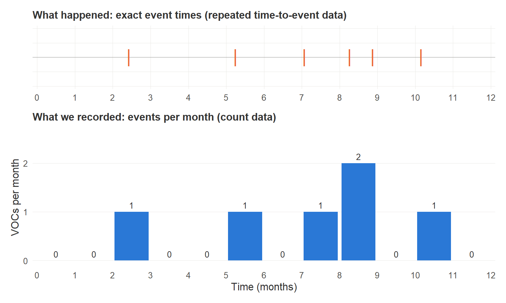
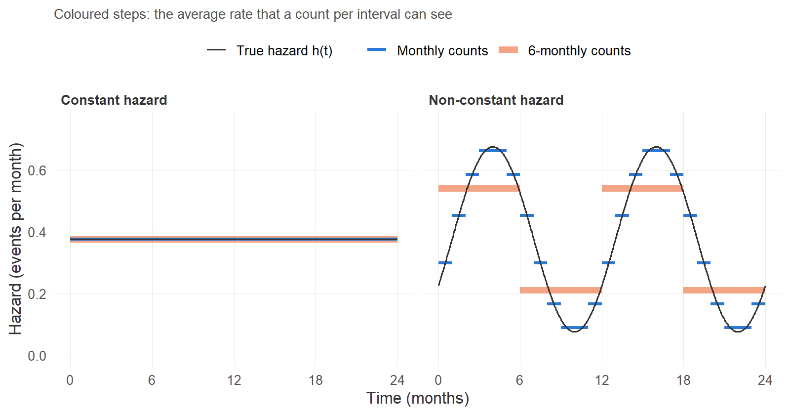
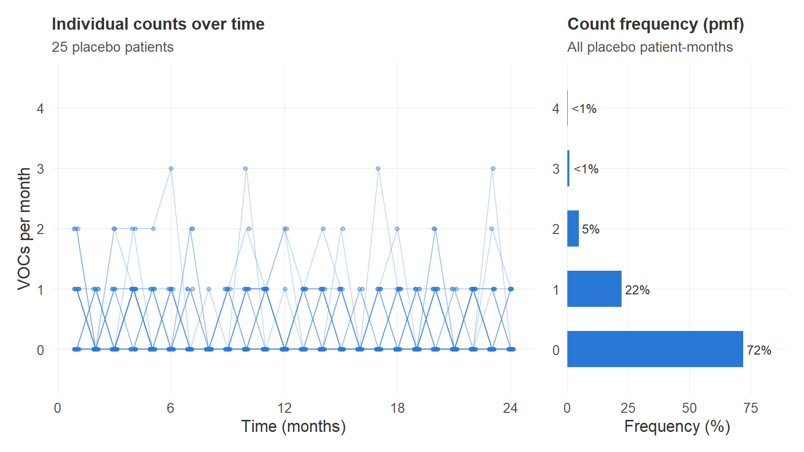
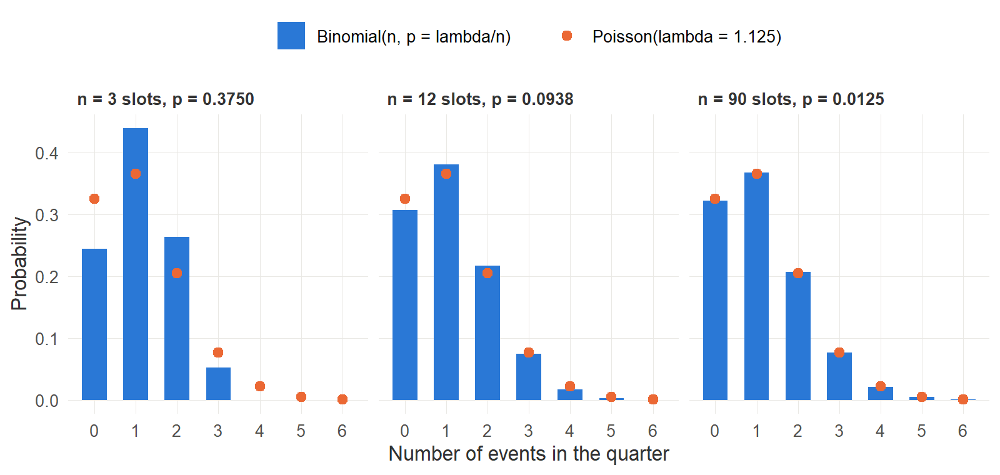
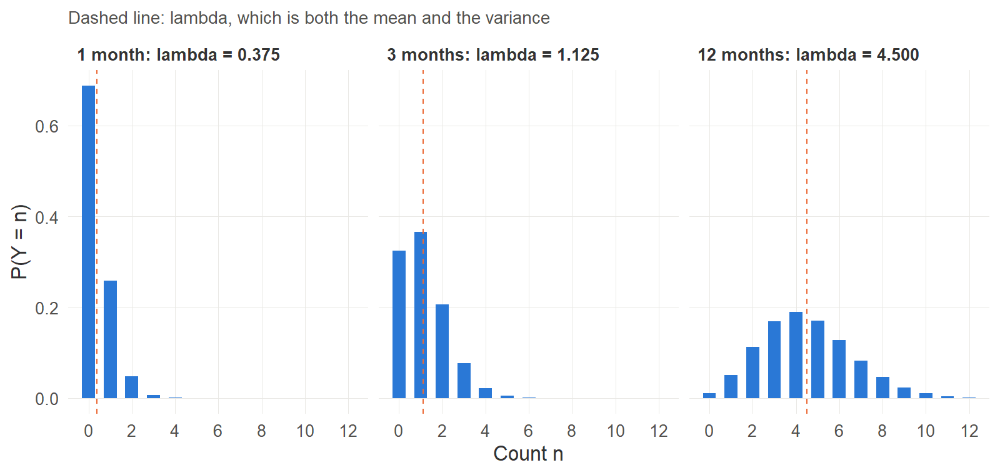
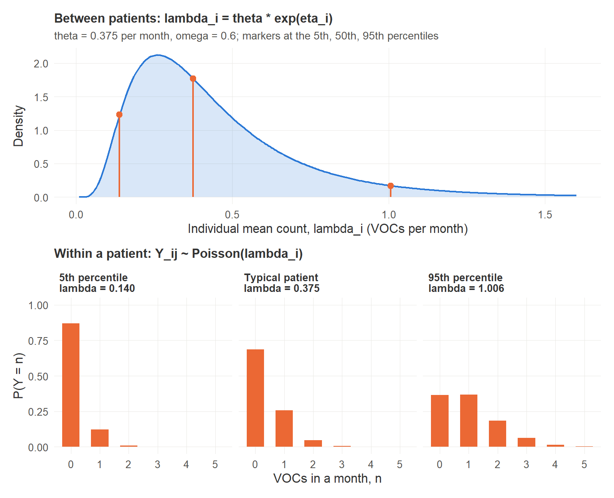
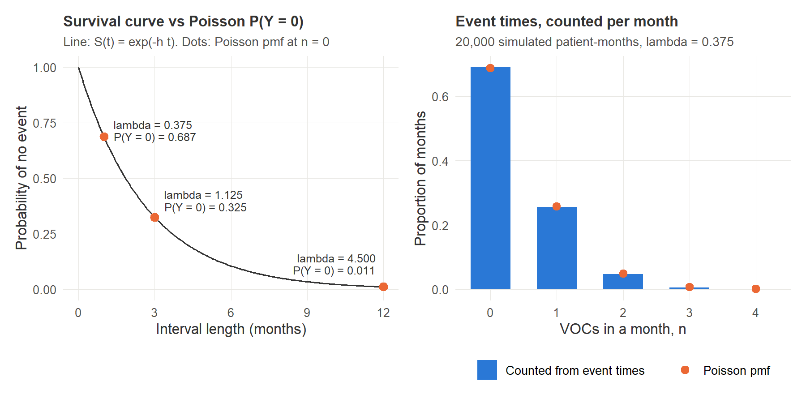
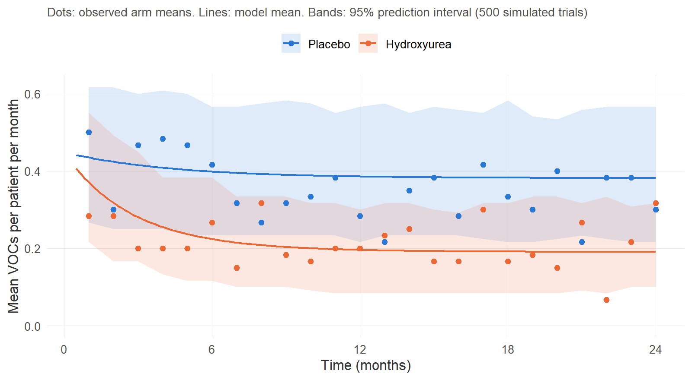

# Modelling Count Data in Pharmacometrics, Part 1: From Events to the Poisson Model

*Part 1 of a three-part series based on Elodie Plan's tutorial "Modeling and Simulation of Count Data" (CPT: Pharmacometrics & Systems Pharmacology, 2014). Every figure is produced by R code you can run yourself; the scripts are in the companion repository: `<add your GitHub repository link>`.*

**Series plan**

1. **Part 1 (this post):** data types, the hazard, the probability mass function, the Poisson model and its mean count function.
2. **Part 2:** what to do when Poisson assumptions fail: overdispersion and underdispersion, truncation, dependence between events, and non-constant rates.
3. **Part 3:** the model-development workflow, diagnostics, simulation, and count models in drug development.

**After this post you should be able to**

- say what count data are, and tell them apart from binary, binomial, ordinal and time-to-event data;
- define a hazard, and explain what is lost when event times are summarized as counts per interval;
- write down the Poisson probability mass function and derive its mean;
- express the mean count λ as a mixed-effects parameter and as a function of time and treatment;
- state the three assumptions of the Poisson model, which Part 2 will then break one by one.

---

## 1. A clinical question that produces counts

Sickle cell anaemia is, for much of its course, a disease of episodes. The episode that brings most patients to hospital is the vaso-occlusive crisis (VOC): an acute, painful event caused by sickled red cells blocking small vessels. A patient may have none in a year, or ten. When we ask whether a drug works in this disease, the question is usually "does it make crises less frequent?"

Two trials frame the example used throughout this series.

- **The Multicenter Study of Hydroxyurea (MSH)** randomized 299 adults who had had at least three crises in the previous year to hydroxyurea or placebo. The annual crisis rate was 2.5 on hydroxyurea against 4.5 on placebo (Charache et al., 1995).
- **REACH** gave hydroxyurea to children aged 1 to 10 years in Angola, the Democratic Republic of Congo, Kenya and Uganda; 606 started treatment. Vaso-occlusive pain fell from 98.3 to 44.6 events per 100 patient-years, an incidence rate ratio of 0.45 (95% CI 0.37 to 0.56) (Tshilolo et al., 2019).

Both results are statements about **counts of events per unit of time**. Neither is a concentration, a blood pressure or a yes/no outcome, and the statistical models we use for those do not fit. This series is about the models that do.

### The teaching dataset

Patient-level data from these trials are not public, so we simulate a trial with the same shape. It is a **hypothetical** design: 120 patients, randomized 1:1 to placebo or hydroxyurea, followed for 24 months, with the number of VOCs recorded each month. The placebo rate is anchored on the MSH placebo arm (4.5 crises per year, which is 0.375 per month) and the treatment effect is a 50% reduction, between the MSH and REACH estimates.

> **Lecturer's note.** Hydroxyurea is now standard of care, so a placebo-controlled trial like this would not be ethical today. The placebo arm is here because it lets us see the natural course and the drug effect side by side, which is what a model has to separate. Treat the dataset as a teaching device, not as evidence.

Here is the shared set-up, followed by the simulation. Do not worry about the model inside `mutate()` yet; sections 6 and 9 explain each term.

```r
# 00_setup.R -- packages, colours and a plain theme shared by every figure
library(ggplot2)
library(dplyr)
library(tidyr)
library(patchwork)

col_placebo <- "#2a78d6"   # blue
col_hu      <- "#eb6834"   # orange
col_third   <- "#1baf7a"   # aqua, used when a third series is needed
col_ink     <- "#333333"
col_muted   <- "#8a8a86"

theme_pmx <- theme_minimal(base_size = 12) +
  theme(
    panel.grid.minor = element_blank(),
    panel.grid.major = element_line(colour = "#e9e8e4", linewidth = 0.3),
    axis.title       = element_text(colour = col_ink),
    axis.text        = element_text(colour = "#52514e"),
    strip.text       = element_text(face = "bold", hjust = 0, colour = col_ink),
    plot.title       = element_text(face = "bold", size = 12, colour = col_ink),
    plot.subtitle    = element_text(size = 10, colour = "#52514e"),
    legend.position  = "top",
    legend.title     = element_blank()
  )
theme_set(theme_pmx)

save_fig <- function(plot, file, width = 8, height = 4.5) {
  dir.create("figures", showWarnings = FALSE)
  ggsave(file.path("figures", file), plot,
         width = width, height = height, dpi = 200, bg = "white")
}
```

```r
# 01_simulate_trial.R -- simulate the teaching trial used throughout the series
# A hypothetical 24-month, two-arm trial of hydroxyurea in sickle cell anaemia.
# Outcome: number of vaso-occlusive crises (VOCs) per patient per month.
source("R/00_setup.R")
set.seed(2026)

n_per_arm <- 60
months    <- 1:24

theta  <- 4.5 / 12       # typical VOC rate per month (4.5 per year, MSH placebo arm)
omega  <- 0.6            # SD of the between-patient random effect (log scale)
p_max  <- 0.15           # maximal "placebo" / regression-to-the-mean reduction
k_p    <- log(2) / 3     # placebo effect half-time: 3 months
e_max  <- 0.50           # maximal hydroxyurea reduction (rate ratio 0.50)
k_on   <- log(2) / 2     # drug effect onset half-time: 2 months

subjects <- tibble(
  id  = seq_len(2 * n_per_arm),
  arm = rep(c("Placebo", "Hydroxyurea"), each = n_per_arm),
  eta = rnorm(2 * n_per_arm, mean = 0, sd = omega)
)

trial <- subjects |>
  crossing(month = months) |>
  mutate(
    f_time = p_max * (1 - exp(-k_p * month)),                      # f(t)
    g_drug = if_else(arm == "Hydroxyurea",
                     e_max * (1 - exp(-k_on * month)), 0),         # g(t)
    lambda = theta * exp(eta) * (1 - f_time) * (1 - g_drug),       # mean count
    count  = rpois(n(), lambda)                                    # observation
  ) |>
  mutate(arm = factor(arm, levels = c("Placebo", "Hydroxyurea"))) |>
  arrange(id, month)

dir.create("data", showWarnings = FALSE)
write.csv(trial, "data/voc_trial_sim.csv", row.names = FALSE)

# Quick look: events per patient-year by arm
trial |>
  group_by(arm) |>
  summarise(patients = n_distinct(id),
            events   = sum(count),
            rate_per_year = sum(count) / (n() / 12))
```

The simulated trial gives 4.25 crises per patient-year on placebo and 2.57 on hydroxyurea, close to the MSH figures it was anchored on.

---

## 2. Know your data type before you choose a model

A model for an outcome is a statement about its probability distribution. Choose the wrong family of distribution and no amount of covariate modelling rescues the analysis. So the first question in any pharmacodynamic analysis is: what kind of number is this?

| Data type | What it is | Sickle cell example | Natural model |
|---|---|---|---|
| Continuous | Any real value in a range | Haemoglobin (g/dL), fetal haemoglobin (%) | Normal or log-normal residual error |
| Binary | One of two outcomes | Acute chest syndrome during an admission: yes or no | Bernoulli (logistic regression) |
| Grouped binary (binomial) | Number of "successes" out of a **known number of trials** | Days with pain out of the 7 days in a diary week | Binomial |
| Nominal categorical | Unordered categories | Reason for admission: pain, infection, anaemia | Multinomial |
| Ordinal categorical | Ordered categories | Pain severity: none, mild, moderate, severe | Proportional odds (ordered categorical) |
| **Count** | Number of events in an interval, **no fixed upper limit** | VOCs per month | Poisson family |
| Time-to-event | Time until an event occurs | Time to first crisis | Hazard (survival) models |
| Repeated time-to-event | Exact time of every event | Date of each crisis over two years | Hazard models for recurrent events |

**Count data are numbers of events per interval.** Three things follow from that definition (Plan, 2014). The event must be defined before the study starts, then recognized and counted. A count is a non-negative integer: 0, 1, 2, and so on. And there is no upper boundary in principle.

That last property is the practical test for separating counts from their most common impostor.

**Counts versus grouped binary data.** "Days with pain this week" looks like a count, but it cannot exceed 7. It is the number of successes in seven yes/no trials, so the binomial distribution, which knows about the maximum, is the right model. "Crises this month" has no such ceiling. The two distributions do converge: when the number of trials is large and the probability per trial is small, the binomial becomes the Poisson. We will prove this in section 5, because it is also the cleanest way to understand where the Poisson distribution comes from.

**What you lose by simplifying counts.** Analysts sometimes dichotomize counts (any crisis: yes or no) or band them (low, medium, high frequency). This is convenient, and it throws away information and statistical power. A patient who goes from six crises a year to one has responded; a yes/no outcome records no change.

**When treating counts as continuous is defensible.** The absolute neutrophil count we monitor on hydroxyurea is literally a count of cells per microlitre. Nobody fits a Poisson model to it. When counts are large and the distribution is wide, the integer steps are negligible and a continuous model works well. The count models in this series matter most when counts are small, which is exactly where a normal distribution would predict impossible values such as −0.4 crises.

---

## 3. The hazard: the process underneath every count

Counts are a summary. What actually happens to a patient is a sequence of events at particular moments. Figure 2 shows the same year of one simulated patient twice: as exact event times, and as monthly counts.



*Figure 2. Six crises in one year. The upper panel is repeated time-to-event data; the lower panel is the count data derived from it. Month 9 holds two events, and the count no longer tells us when in the month they occurred.*

```r
# Figure 2 -- the same events seen as exact times (RTTE) and as monthly counts
source("R/00_setup.R")
set.seed(22)   # chosen so that one month holds two events

h    <- 4.5 / 12                           # constant hazard, events per month
gaps <- rexp(40, rate = h)                 # waiting times between events
t_ev <- cumsum(gaps)
t_ev <- t_ev[t_ev <= 12]                   # keep the first 12 months

events <- tibble(time = t_ev)
counts <- tibble(month = 1:12,
                 count = tabulate(ceiling(t_ev), nbins = 12))

p_events <- ggplot(events, aes(time, 0)) +
  geom_vline(xintercept = 0:12, colour = "#e9e8e4", linewidth = 0.3) +
  geom_hline(yintercept = 0, colour = col_muted, linewidth = 0.3) +
  geom_point(shape = 124, size = 7, colour = col_hu) +
  scale_x_continuous(breaks = 0:12, limits = c(0, 12), expand = c(0.01, 0)) +
  scale_y_continuous(limits = c(-1, 1)) +
  labs(title = "What happened: exact event times (repeated time-to-event data)",
       x = NULL, y = NULL) +
  theme(axis.text.y = element_blank(), panel.grid = element_blank())

p_counts <- ggplot(counts, aes(month - 0.5, count)) +
  geom_col(fill = col_placebo, width = 0.9) +
  geom_text(aes(label = count), vjust = -0.5, size = 3.4, colour = col_ink) +
  scale_x_continuous(breaks = 0:12, limits = c(0, 12), expand = c(0.01, 0)) +
  scale_y_continuous(breaks = 0:3, limits = c(0, max(counts$count) + 0.6)) +
  labs(title = "What we recorded: events per month (count data)",
       x = "Time (months)", y = "VOCs per month") +
  theme(panel.grid.major.x = element_blank())

save_fig(p_events / p_counts + plot_layout(heights = c(1, 2.2)),
         "fig02_events_to_counts.png", height = 4.8)
```

The quantity that drives the upper panel is the **hazard**.

### Definition

Let *T* be the time of the next event. The hazard is the instantaneous rate at which events occur at time *t*, given that the event has not yet occurred:

$$
h(t) = \lim_{\Delta t \to 0} \frac{P(t \le T < t + \Delta t \mid T \ge t)}{\Delta t} \qquad (1)
$$

Three points about equation 1.

- A hazard is a **rate, not a probability**. Its units are events per unit time, and it can exceed 1. A hazard of 4.5 per year is the same as 0.375 per month.
- For a short interval, *h(t)* × Δ*t* is approximately the probability of an event in that interval.
- Events are assumed to be instantaneous and to occur one at a time.

Two functions are built from the hazard. The **cumulative hazard** is the hazard accumulated up to time *t*, and the **survival function** is the probability that no event has occurred by time *t*:

$$
H(t) = \int_0^t h(u)\,du, \qquad S(t) = P(T > t) = e^{-H(t)} \qquad (2)
$$

### Constant and non-constant hazard

If the hazard does not change with time, *h(t) = h*, then *H(t) = h·t* and *S(t) = e^(−h·t)*. Waiting times between events follow an exponential distribution with mean 1/*h*. This is the simplest possible event process and, as we will see, it is exactly the process the Poisson model assumes within each counting interval.

A **non-constant hazard** changes with time. In a drug trial it almost always does: the disease progresses, a placebo response sets in, drug concentrations rise and fall, the season changes.

### What counting per interval can and cannot see

A count over an interval responds to the *accumulated* hazard over that interval, that is, to its average. It cannot see how the hazard moved inside the interval. Figure 3 makes this concrete with a hazard that swings seasonally around the same average of 0.375 per month.



*Figure 3. Black line: the true hazard. Coloured steps: the average hazard over each counting interval. With a constant hazard (left) nothing is lost, whatever the interval. With a time-varying hazard (right), monthly counts follow the curve closely; six-monthly counts flatten it.*

```r
# Figure 3 -- constant vs non-constant hazard, and what interval counting keeps
source("R/00_setup.R")

h0 <- 4.5 / 12
h_const <- function(t) rep(h0, length(t))
h_vary  <- function(t) h0 * (1 + 0.8 * sin(2 * pi * (t - 1) / 12))   # a seasonal swing

# average hazard over each interval of a given width = expected count / width
interval_mean <- function(h, width, t_end = 24) {
  starts <- seq(0, t_end - width, by = width)
  tibble(start = starts, end = starts + width,
         h_bar = sapply(starts, function(s) integrate(h, s, s + width)$value / width))
}

grid <- tibble(t = seq(0, 24, by = 0.05))
curves <- bind_rows(
  grid |> mutate(panel = "Constant hazard", h = h_const(t)),
  grid |> mutate(panel = "Non-constant hazard", h = h_vary(t))
)
steps <- bind_rows(
  interval_mean(h_const, 1) |> mutate(panel = "Constant hazard",     what = "Monthly counts"),
  interval_mean(h_const, 6) |> mutate(panel = "Constant hazard",     what = "6-monthly counts"),
  interval_mean(h_vary,  1) |> mutate(panel = "Non-constant hazard", what = "Monthly counts"),
  interval_mean(h_vary,  6) |> mutate(panel = "Non-constant hazard", what = "6-monthly counts")
) |>
  mutate(what = factor(what, levels = c("Monthly counts", "6-monthly counts")))

p <- ggplot() +
  geom_segment(data = filter(steps, what == "6-monthly counts"),
               aes(x = start, xend = end, y = h_bar, yend = h_bar, colour = what),
               linewidth = 2.2, alpha = 0.6) +
  geom_segment(data = filter(steps, what == "Monthly counts"),
               aes(x = start, xend = end, y = h_bar, yend = h_bar, colour = what),
               linewidth = 1.1) +
  geom_line(data = curves, aes(t, h, linetype = "True hazard h(t)"),
            colour = col_ink, linewidth = 0.6) +
  facet_wrap(~ panel) +
  scale_colour_manual(values = c("Monthly counts" = col_placebo,
                                 "6-monthly counts" = col_hu),
                      breaks = c("Monthly counts", "6-monthly counts")) +
  scale_linetype_manual(values = c("True hazard h(t)" = "solid")) +
  scale_x_continuous(breaks = seq(0, 24, 6)) +
  scale_y_continuous(limits = c(0, 0.75)) +
  labs(x = "Time (months)", y = "Hazard (events per month)",
       subtitle = "Coloured steps: the average rate that a count per interval can see")

save_fig(p, "fig03_hazard.png", height = 4.2)
```

In the right-hand panel the true hazard ranges from 0.075 to 0.675 per month, a nine-fold swing. Six-monthly counts see averages of 0.54 and 0.21, a 2.6-fold swing. Annual counts would see 0.375 every year: the seasonal effect disappears. This is what Plan calls **dilution**: when time affects the hazard, summarizing the events as counts per interval dilutes the effect, to an extent that depends on the shape of the time effect and on where the interval boundaries fall.

The practical rules that follow:

- The shorter the interval, the less is summarized away.
- If the scientific aim is to characterize a time-varying hazard as accurately as possible, a **repeated time-to-event** analysis of the exact event times is more appropriate than a count analysis, although it is slower to run.
- If events are rare and intervals short, so that each interval holds zero or one event, the two analyses carry essentially the same information.

> **Lecturer's note.** The choice of counting interval is a design decision with modelling consequences. Where crises are recalled at a routine clinic visit and not dated, as is common when follow-up is monthly or quarterly, the data are counts by construction. No repeated time-to-event analysis is possible, and the count model is the tool you have.

---

## 4. Looking at counts: the probability mass function

Two plots should open every count analysis (Figure 1).



*Figure 1. Left: monthly VOC counts for 25 placebo patients. Right: the frequency of each count value across all placebo patient-months, drawn sideways so that the two panels share the same vertical axis.*

```r
# Figure 1 -- counts over time, and the same counts as a probability mass function
source("R/00_setup.R")
trial <- read.csv("data/voc_trial_sim.csv")

placebo <- filter(trial, arm == "Placebo")
set.seed(1)
shown   <- filter(placebo, id %in% sample(unique(id), 25))
y_max   <- max(placebo$count)

p_time <- ggplot(shown, aes(month, count, group = id)) +
  geom_line(colour = col_placebo, alpha = 0.25, linewidth = 0.4) +
  geom_point(colour = col_placebo, alpha = 0.35, size = 1.2,
             position = position_jitter(width = 0.15, height = 0, seed = 1)) +
  scale_x_continuous(breaks = seq(0, 24, 6)) +
  scale_y_continuous(breaks = 0:y_max, limits = c(-0.5, y_max + 0.5)) +
  labs(title = "Individual counts over time",
       subtitle = "25 placebo patients",
       x = "Time (months)", y = "VOCs per month")

pmf <- placebo |>
  count(count, name = "n") |>
  mutate(pct = 100 * n / sum(n))

p_pmf <- ggplot(pmf, aes(pct, count)) +
  geom_col(orientation = "y", fill = col_placebo, width = 0.6) +
  geom_text(aes(label = ifelse(pct < 1, "<1%", sprintf("%.0f%%", pct))), hjust = -0.15,
            size = 3.2, colour = col_ink) +
  scale_x_continuous(expand = expansion(mult = c(0, 0.25))) +
  scale_y_continuous(breaks = 0:y_max, limits = c(-0.5, y_max + 0.5)) +
  labs(title = "Count frequency (pmf)",
       subtitle = "All placebo patient-months",
       x = "Frequency (%)", y = NULL)

save_fig(p_time + p_pmf + plot_layout(widths = c(2.2, 1)),
         "fig01_counts_and_pmf.png")
```

The **time-course plot** on the left is the familiar dependent variable against time. It shows variability between patients and any trend. It also shows why counts are awkward to plot: the lines collapse onto a few integer values.

The **frequency histogram** on the right is the more informative of the two. It shows the *shape* of the distribution: here 72% of patient-months have no crisis, 22% have one, and the remainder tail off quickly.

That histogram is an empirical **probability mass function (pmf)**. For a discrete random variable *Y*, the pmf gives the probability of each value it can take:

$$
p(n) = P(Y = n), \qquad p(n) \ge 0, \qquad \sum_{n=0}^{\infty} p(n) = 1 \qquad (3)
$$

Compare this with the **probability density function (pdf)** used for continuous data. A pdf is a curve whose *area* over a range gives a probability; the probability of any single exact value is zero. A pmf puts a real lump of probability on each integer; the *heights* themselves are probabilities and they sum to one. This is why the likelihood of a count observation is simply the pmf evaluated at the observed count.

Almost everything we add to a count model from here on (the mean count, between-patient variability, drug effect, dispersion parameters) acts by changing the shape of this pmf.

---

## 5. The Poisson model

The Poisson model is the reference count model. Every other count model in this series reduces to it when its extra parameter goes to a limiting value, so it is where model building starts. The distribution is named after Siméon Denis Poisson, although de Moivre had published the idea about a century earlier.

### Where it comes from: the limit of the binomial

Take one quarter (three months) for a patient whose expected number of crises in that quarter is λ = 1.125. Divide the quarter into *n* equal slots, short enough that each slot holds at most one event. If each slot independently holds an event with probability *p* = λ/*n*, the number of events *Y* in the quarter is binomial:

$$
P(Y = k) = \binom{n}{k}\left(\frac{\lambda}{n}\right)^{k}\left(1 - \frac{\lambda}{n}\right)^{n-k} \qquad (4)
$$

Now make the slots finer and finer, *n* → ∞, keeping λ fixed. Rearranging equation 4:

$$
P(Y = k) = \frac{\lambda^{k}}{k!}\;\underbrace{\frac{n(n-1)\cdots(n-k+1)}{n^{k}}}_{\to\,1}\;\underbrace{\left(1 - \frac{\lambda}{n}\right)^{n}}_{\to\,e^{-\lambda}}\;\underbrace{\left(1 - \frac{\lambda}{n}\right)^{-k}}_{\to\,1}
$$

and the limit is the Poisson pmf. Figure 4 shows the convergence: with three slots (months) the binomial is visibly different, with twelve (weeks) it is close, and with ninety (days) the two are indistinguishable.



*Figure 4. Bars: binomial probabilities for n slots with p = λ/n. Dots: Poisson probabilities with λ = 1.125. The mean is held constant while the slots become finer.*

```r
# Figure 4 -- the Poisson distribution as the limit of the binomial
source("R/00_setup.R")

lambda <- 4.5 / 4                      # expected VOCs in one quarter (3 months)
n_slots <- c(3, 12, 90)                # months, weeks, days in a quarter

binom <- crossing(n = n_slots, k = 0:6) |>
  mutate(prob  = dbinom(k, size = n, prob = lambda / n),
         panel = factor(sprintf("n = %d slots, p = %.4f", n, lambda / n),
                        levels = sprintf("n = %d slots, p = %.4f", n_slots, lambda / n_slots)))
pois <- binom |> mutate(prob = dpois(k, lambda))

p <- ggplot(binom, aes(k, prob)) +
  geom_col(aes(fill = "Binomial(n, p = lambda/n)"), width = 0.6) +
  geom_point(data = pois, aes(colour = "Poisson(lambda = 1.125)"), size = 2.4) +
  facet_wrap(~ panel) +
  scale_fill_manual(values = c("Binomial(n, p = lambda/n)" = col_placebo)) +
  scale_colour_manual(values = c("Poisson(lambda = 1.125)" = col_hu)) +
  scale_x_continuous(breaks = 0:6) +
  guides(fill = guide_legend(order = 1), colour = guide_legend(order = 2)) +
  labs(x = "Number of events in the quarter", y = "Probability")

save_fig(p, "fig04_binomial_to_poisson.png", height = 3.8)
```

The derivation tells us what the Poisson model assumes: many small opportunities for an event, each with the same small probability, each independent of the others. Keep those three words in mind (many, same, independent); they return as the model's assumptions in section 7.

### The probability mass function

An observation *Y* for individual *i* during interval *j* follows a Poisson distribution when the probability that it takes the value *n* = 0, 1, 2, … is

$$
P(Y_{ij} = n) = \frac{\lambda_i^{\,n}\; e^{-\lambda_i}}{n!} \qquad (5)
$$

where *n*! is the factorial of *n* and λ*ᵢ* is the single parameter of the model.

### The mean count parameter λ

λ (lambda) is the **mean count**: the expected number of events in the interval. It is a positive real number and does not have to be an integer; a patient can have an expected 0.375 crises per month even though any actual month holds 0, 1, 2 or more.

That the expectation equals λ is worth deriving once. By definition of the expectation, and noting that the *n* = 0 term contributes nothing:

$$
E(Y) = \sum_{n=0}^{\infty} n\,\frac{\lambda^{n} e^{-\lambda}}{n!}
     = \lambda e^{-\lambda}\sum_{n=1}^{\infty}\frac{\lambda^{\,n-1}}{(n-1)!}
     = \lambda e^{-\lambda}\, e^{\lambda} = \lambda \qquad (6)
$$

The last step uses the series expansion of *e^λ*. A parallel calculation gives the variance, and it is the same number:

$$
E(Y_{ij}) = \operatorname{Var}(Y_{ij}) = \lambda_i \qquad (7)
$$

A normal distribution has one parameter for its centre and another for its spread. The Poisson distribution has one parameter for both. This is a strong restriction, and it is the first assumption Part 2 will relax.

Figure 5 shows what λ does to the pmf, using one hazard and three interval lengths.



*Figure 5. The same hazard of 0.375 events per month, counted per month, per quarter and per year. As λ grows, the probability of zero falls, the distribution becomes less skewed and more like a normal distribution, and the spread increases.*

```r
# Figure 5 -- one hazard, three interval lengths, three Poisson pmfs
source("R/00_setup.R")

h <- 4.5 / 12                                   # events per month
intervals <- tibble(label = c("1 month", "3 months", "12 months"),
                    dt    = c(1, 3, 12)) |>
  mutate(lambda = h * dt,
         panel  = sprintf("%s: lambda = %.3f", label, lambda),
         panel  = factor(panel, levels = panel))

pmf <- intervals |>
  crossing(n = 0:12) |>
  mutate(prob = dpois(n, lambda))

p <- ggplot(pmf, aes(n, prob)) +
  geom_col(fill = col_placebo, width = 0.6) +
  geom_vline(aes(xintercept = lambda), colour = col_hu, linetype = "dashed",
             linewidth = 0.5) +
  facet_wrap(~ panel) +
  scale_x_continuous(breaks = seq(0, 12, 2)) +
  labs(x = "Count n", y = "P(Y = n)",
       subtitle = "Dashed line: lambda, which is both the mean and the variance")

save_fig(p, "fig05_poisson_pmf.png", height = 3.8)
```

For the typical patient at 0.375 crises per month, equation 5 gives *P*(0) = 0.687, *P*(1) = 0.258, *P*(2) = 0.048 and *P*(3) = 0.006. In R these are `dpois(0:3, lambda = 0.375)`.

---

## 6. λ as a mixed-effects parameter

Patients differ. One has a crisis every other month, another one a year. A single λ for everyone cannot describe that, and the population approach handles it the same way as for a clearance or a volume: as a **mixed effect**, the combination of a fixed effect and a random effect.

$$
\lambda_i = \theta \cdot e^{\eta_i}, \qquad \eta_i \sim N(0, \omega^2) \qquad (8)
$$

- **θ (theta)** is the **fixed effect**: the mean count of the typical individual. One value for the population.
- **η*ᵢ* (eta)** is the **random effect**: how far individual *i* sits from the typical value, on the log scale. One value per individual, drawn from a normal distribution with mean zero.
- **ω² (omega squared)** is the variance of the random effects, the **interindividual variability (IIV)**. It is the parameter we estimate; the individual η values are predicted afterwards.

Why the exponential? Because λ must be positive. Whatever value η takes, *θ·e^η* is greater than zero. The consequence is that λ*ᵢ* is **log-normally distributed** across the population, which has three properties worth knowing:

$$
\text{median}(\lambda_i) = \theta, \qquad
E(\lambda_i) = \theta\, e^{\omega^2/2}, \qquad
\text{CV}(\lambda_i) = \sqrt{e^{\omega^2} - 1} \qquad (9)
$$

In our simulation θ = 0.375 per month and ω = 0.6. The typical (median) patient therefore has 0.375 crises per month, but the population *mean* is 0.375 × *e*^0.18 = 0.449, about 20% higher, and the coefficient of variation is 66%. The typical value and the population mean are different numbers. This matters whenever you compare a model's θ with a trial's reported mean rate.

With the random effect in place, λ*ᵢ* is interpretable as **the mean number of events per interval for individual *i***, and the model has two levels (Figure 6).



*Figure 6. Top: the log-normal distribution of individual mean counts. Bottom: the Poisson pmf for three patients drawn from it. The patient at the 5th percentile has no crisis in 87% of months; the patient at the 95th percentile, in only 37%.*

```r
# Figure 6 -- from one population value (theta) to individual mean counts (lambda_i)
source("R/00_setup.R")

theta <- 4.5 / 12
omega <- 0.6

people <- tibble(who = c("5th percentile", "Typical patient", "95th percentile"),
                 eta = qnorm(c(0.05, 0.50, 0.95), mean = 0, sd = omega)) |>
  mutate(lambda = theta * exp(eta),
         panel  = sprintf("%s\nlambda = %.3f", who, lambda),
         panel  = factor(panel, levels = panel))

dens <- tibble(lambda = seq(0.01, 1.6, by = 0.005)) |>
  mutate(d = dlnorm(lambda, meanlog = log(theta), sdlog = omega))

p_dens <- ggplot(dens, aes(lambda, d)) +
  geom_area(fill = col_placebo, alpha = 0.18) +
  geom_line(colour = col_placebo, linewidth = 0.7) +
  geom_segment(data = people,
               aes(x = lambda, xend = lambda, y = 0,
                   yend = dlnorm(lambda, log(theta), omega)),
               colour = col_hu, linewidth = 0.7) +
  geom_point(data = people, aes(lambda, dlnorm(lambda, log(theta), omega)),
             colour = col_hu, size = 2.4) +
  labs(title = "Between patients: lambda_i = theta * exp(eta_i)",
       subtitle = "theta = 0.375 per month, omega = 0.6; markers at the 5th, 50th, 95th percentiles",
       x = "Individual mean count, lambda_i (VOCs per month)", y = "Density")

pmf <- people |>
  crossing(n = 0:5) |>
  mutate(prob = dpois(n, lambda))

p_pmf <- ggplot(pmf, aes(n, prob)) +
  geom_col(fill = col_hu, width = 0.6) +
  facet_wrap(~ panel) +
  scale_x_continuous(breaks = 0:5) +
  scale_y_continuous(limits = c(0, 1)) +
  labs(title = "Within a patient: Y_ij ~ Poisson(lambda_i)",
       x = "VOCs in a month, n", y = "P(Y = n)")

save_fig(p_dens / p_pmf, "fig06_mixed_effects.png", height = 6.5)
```

### What this does to the likelihood

For one patient, the observations in different months are independent *given that patient's* η, so their joint probability is a product of Poisson pmfs. But η is not observed, so the contribution of patient *i* to the likelihood averages over every value η could take:

$$
L_i(\theta, \omega^2) = \int \left[\prod_{j} \frac{\lambda_{ij}^{\,n_{ij}}\, e^{-\lambda_{ij}}}{n_{ij}!}\right] \phi(\eta;\, 0, \omega^2)\, d\eta \qquad (10)
$$

where φ is the normal density. This integral has no closed form, which is why estimation software approximates it. For count models the approximation matters more than usual: Plan notes that the first-order conditional method (FOCE) should not be used, and that the Laplace approximation or sampling-based methods such as SAEM are appropriate. Part 3 returns to this.

---

## 7. Three properties of the Poisson model

Every model is a set of assumptions. The Poisson model makes three, and they map directly onto the "many, same, independent" of the binomial derivation.

**1. Equidispersion: the mean equals the variance.** From equation 7, an individual's λ*ᵢ* defines both the mean and the variance of that individual's counts. It should be checked during data exploration and stated in the model report. It is restrictive, yet it holds for many biological processes.

A caution that catches many beginners: equidispersion is a property of **one individual's** distribution. In our simulated placebo arm every patient is perfectly Poisson, yet the pooled data have mean 0.354 and variance 0.405. The excess comes entirely from patients having different λ*ᵢ*. Pooling across patients is not a test of equidispersion; the check has to be made within individuals, and Part 2 shows how.

**2. Independence between events: a memoryless process.** The occurrence of one event does not change the probability of another. This is acceptable for dice. For symptoms it is often doubtful: a crisis may leave a patient more vulnerable to the next, or the treatment given for one may delay the next.

**3. A constant event rate within each interval: a homogeneous process.** Inside a counting interval the hazard is assumed flat. This is partly forced on us by the data: if we only know the monthly total, we have no information about what happened within the month. The rate may still change *between* intervals, which is what section 9 exploits.

> **A note on terminology.** "Memoryless" and "Markovian" are sometimes used loosely as if they meant the same thing. In this series, as in Plan's tutorial, independence (memorylessness) is the Poisson *assumption*; Markov models are one of the *remedies* used when that assumption fails, because they let the current count depend on the previous one. Part 2 covers them.

| Assumption | Violated when | Addressed in Part 2 by |
|---|---|---|
| Equidispersion | Variance above or below the mean within individuals | Negative binomial, generalized Poisson, double Poisson, zero-inflated models |
| Independence | Events cluster, or are spaced too regularly | Markov elements |
| Constant rate within intervals | A fast-changing biomarker or drug concentration drives the hazard | Non-homogeneous Poisson models |

---

## 8. Two exponential models that are one model

Section 3 said that counts are driven by a hazard. We can now show that the Poisson model and the constant-hazard model are the same model seen from two sides. Plan does this by computing one quantity both ways: the probability of **no event** in an interval.

From the Poisson pmf (equation 5) with *n* = 0:

$$
P(Y_{ij} = 0) = \frac{\lambda_i^{\,0}\, e^{-\lambda_i}}{0!} = e^{-\lambda_i} \qquad (11)
$$

From the time-to-event side, "no event in the interval from *t*ⱼ₋₁ to *t*ⱼ" is survival through that interval. With a constant hazard *h*ᵢ, equation 2 gives:

$$
P(Y_{ij} = 0) = \exp\!\left(-\int_{t_{j-1}}^{t_j} h_i(u)\,du\right) = e^{-h_i\,(t_j - t_{j-1})} \qquad (12)
$$

Setting equations 11 and 12 equal:

$$
\lambda_i = h_i \cdot (t_j - t_{j-1}) \qquad (13)
$$

**The mean count is the hazard multiplied by the length of the interval.** λ is the cumulative hazard over the counting interval. This single line explains Figure 5 (the same hazard, three interval lengths, three values of λ), and it tells you how to handle unequal intervals: a patient counted daily in hospital and weekly at home has the same *h* and a different Δ*t*.

Figure 7 checks the equivalence by brute force. We simulate **event times** with exponential waiting times, with no Poisson distribution anywhere in the code, count the events in each month, and compare the result with the Poisson pmf.



*Figure 7. Left: the survival curve for a constant hazard passes exactly through the Poisson probabilities of a zero count. Right: counts obtained from 20,000 simulated patient-months of exponential event times match the Poisson pmf.*

```r
# Figure 7 -- the Poisson model and the constant-hazard model are the same model
source("R/00_setup.R")
set.seed(42)

h <- 4.5 / 12                                   # constant hazard, per month

# (a) survival curve S(t) = exp(-h t), and P(Y = 0) from the Poisson pmf
surv   <- tibble(t = seq(0, 12, by = 0.05)) |> mutate(S = exp(-h * t))
marks  <- tibble(t = c(1, 3, 12)) |>
  mutate(p0    = dpois(0, lambda = h * t),
         label = sprintf("lambda = %.3f\nP(Y = 0) = %.3f", h * t, p0))

p_surv <- ggplot(surv, aes(t, S)) +
  geom_line(colour = col_ink, linewidth = 0.6) +
  geom_point(data = marks, aes(t, p0), colour = col_hu, size = 2.8) +
  geom_text(data = marks, aes(t, p0, label = label), hjust = c(-0.12, -0.12, 1.1),
            vjust = c(0.2, -0.3, -0.6), size = 3.1, colour = col_ink, lineheight = 0.95) +
  scale_x_continuous(breaks = seq(0, 12, 3)) +
  scale_y_continuous(limits = c(0, 1)) +
  labs(title = "Survival curve vs Poisson P(Y = 0)",
       subtitle = "Line: S(t) = exp(-h t). Dots: Poisson pmf at n = 0",
       x = "Interval length (months)", y = "Probability of no event")

# (b) simulate event TIMES with exponential gaps, count per month, compare with dpois
n_months <- 20000
t_ev   <- cumsum(rexp(2 * h * n_months, rate = h))
t_ev   <- t_ev[t_ev <= n_months]
counts <- tabulate(ceiling(t_ev), nbins = n_months)

emp <- tibble(n = 0:4) |>
  mutate(simulated = sapply(n, function(k) mean(counts == k)),
         poisson   = dpois(n, h))

p_sim <- ggplot(emp, aes(n)) +
  geom_col(aes(y = simulated, fill = "Counted from event times"), width = 0.6) +
  geom_point(aes(y = poisson, colour = "Poisson pmf"), size = 2.6) +
  scale_fill_manual(values = c("Counted from event times" = col_placebo)) +
  scale_colour_manual(values = c("Poisson pmf" = col_hu)) +
  labs(title = "Event times, counted per month",
       subtitle = "20,000 simulated patient-months, lambda = 0.375",
       x = "VOCs in a month, n", y = "Proportion of months") +
  guides(fill = guide_legend(order = 1), colour = guide_legend(order = 2)) +
  theme(legend.position = "bottom")

save_fig(p_surv + p_sim, "fig07_poisson_hazard_link.png", width = 9)
print(emp)
```

The formal result is older than pharmacometrics. In 1980 and 1981, Holford and, independently, Laird and Olivier proved that a piecewise proportional hazards model and a Poisson regression model are mathematically equivalent and give identical estimates. The practical value of knowing this lies in interpretation: a drug effect on λ is a drug effect on the hazard, and a rate ratio from a count model can be read as a hazard ratio under a piecewise-constant hazard.

### "Exponential family": a second meaning

The heading "exponential model family" in the tutorial refers to the link just shown. Statisticians also use *exponential family* for a class of distributions whose pmf or pdf can be written in a particular exponential form. The Poisson belongs to it:

$$
P(Y = n) = \exp\{\,n \log\lambda - \lambda - \log n!\,\} \qquad (14)
$$

The term multiplying the data, log λ, is the *natural parameter*. This is why Poisson regression uses a log link, why count models are so often written on the log scale (equation 16 below), and it is the starting point for the *double* exponential family behind the double Poisson model in Part 2.

---

## 9. The mean count function: where pharmacology enters

So far λ*ᵢ* has been one number per patient. But in the standard Poisson model λ only has to be constant *within* an interval; it is free to change *between* intervals. That turns λ from a parameter into a function, and it is the function on which disease progression and drug effect are modelled.

Plan's general form is:

$$
\lambda_{ij} = \theta \cdot e^{\eta_i}
\cdot \bigl(1 - f(t_j)\bigr)
\cdot \bigl(1 - g(\mathrm{PK}_i(t_j))\bigr)
\cdot \bigl(1 + \alpha_1 X_{1} + \cdots + \alpha_K X_{K}\bigr) \qquad (15)
$$

Reading from left to right:

- **θ·e^ηᵢ** is the individual's baseline mean count (section 6).
- **f(tⱼ)** is the effect of time: natural history of the disease, or a placebo response. In sickle cell trials that enrol patients *because* they recently had frequent crises, some decline is expected from regression to the mean alone.
- **g(PKᵢ(tⱼ))** is the drug effect, driven by a pharmacokinetic exposure metric. Because exposure has to represent the whole counting interval, it is usually a **summary metric**, such as steady-state concentration or average AUC, and not the concentration at one moment.
- **α₁X₁ … α_K X_K** are covariate effects.

If *f* and *g* are functions that rise from 0 towards a maximum below 1, the mean count can fall towards zero but can never become negative. An exponential approach to a plateau and a sigmoid Emax function are the usual choices.

Our simulated trial uses exactly this structure, with treatment arm standing in for exposure:

$$
f(t) = P_{\max}\,(1 - e^{-k_p t}), \qquad
g(t) = E_{\max}\,(1 - e^{-k_{on} t}) \;\text{ on hydroxyurea, } 0 \text{ on placebo}
$$

with *P*max = 0.15, *E*max = 0.50, and half-times of 3 and 2 months. The gradual onset of *g* mimics the months it takes for hydroxyurea to raise fetal haemoglobin. Look back at the `mutate()` call in the simulation code: `f_time`, `g_drug` and `lambda` are these three expressions, and `rpois(n(), lambda)` is equation 5.

Many modellers prefer to write the same idea on the log scale:

$$
\log(\lambda_{ij}) = \theta + \eta_i + f(t_j) + g(\mathrm{PK}_i(t_j)) + \alpha_1 X_1 + \cdots + \alpha_K X_K \qquad (16)
$$

Here effects add on the log scale, which means they multiply on the natural scale, and positivity is guaranteed without any constraint on *f* and *g*. Note that θ in equation 16 is a log mean count, so it is **not** directly comparable with θ in equation 15.

Figure 8 shows the mean count function at work.



*Figure 8. Mean VOCs per patient per month. The placebo arm declines slightly (the time effect f); the hydroxyurea arm declines further and faster (f and g together). The bands show how much an arm mean of 60 patients varies from one simulated trial to the next.*

```r
# Figure 8 -- lambda as a function of time and treatment
source("R/00_setup.R")
trial <- read.csv("data/voc_trial_sim.csv") |>
  mutate(arm = factor(arm, levels = c("Placebo", "Hydroxyurea")))
set.seed(7)

theta <- 4.5 / 12; omega <- 0.6
p_max <- 0.15; k_p  <- log(2) / 3
e_max <- 0.50; k_on <- log(2) / 2

# model-based population mean: E[theta * exp(eta)] = theta * exp(omega^2 / 2)
model <- crossing(arm = levels(trial$arm), month = seq(0.5, 24, by = 0.1)) |>
  mutate(arm    = factor(arm, levels = levels(trial$arm)),
         f_time = p_max * (1 - exp(-k_p * month)),
         g_drug = if_else(arm == "Hydroxyurea", e_max * (1 - exp(-k_on * month)), 0),
         mean_count = theta * exp(omega^2 / 2) * (1 - f_time) * (1 - g_drug))

# 95% prediction interval for the arm mean: re-simulate the whole trial 500 times
design <- distinct(trial, id, arm) |> crossing(month = 1:24) |>
  mutate(f_time = p_max * (1 - exp(-k_p * month)),
         g_drug = if_else(arm == "Hydroxyurea", e_max * (1 - exp(-k_on * month)), 0))
n_id <- n_distinct(design$id)

one_trial <- function(rep) {
  eta <- rnorm(n_id, 0, omega)
  design |>
    mutate(count = rpois(n(), theta * exp(eta[id]) * (1 - f_time) * (1 - g_drug))) |>
    group_by(arm, month) |>
    summarise(mean_count = mean(count), .groups = "drop")
}
pi95 <- bind_rows(lapply(1:500, one_trial)) |>
  group_by(arm, month) |>
  summarise(lo = quantile(mean_count, 0.025), hi = quantile(mean_count, 0.975),
            .groups = "drop")

observed <- trial |>
  group_by(arm, month) |>
  summarise(mean_count = mean(count), .groups = "drop")

p <- ggplot(mapping = aes(month, colour = arm, fill = arm)) +
  geom_ribbon(data = pi95, aes(ymin = lo, ymax = hi), alpha = 0.15, colour = NA) +
  geom_line(data = model, aes(y = mean_count), linewidth = 0.8) +
  geom_point(data = observed, aes(y = mean_count), size = 1.8) +
  scale_colour_manual(values = c(Placebo = col_placebo, Hydroxyurea = col_hu)) +
  scale_fill_manual(values = c(Placebo = col_placebo, Hydroxyurea = col_hu)) +
  scale_x_continuous(breaks = seq(0, 24, 6)) +
  scale_y_continuous(limits = c(0, NA)) +
  labs(x = "Time (months)", y = "Mean VOCs per patient per month",
       subtitle = "Dots: observed arm means. Lines: model mean. Bands: 95% prediction interval (500 simulated trials)")

save_fig(p, "fig08_mean_count_function.png", height = 4.4)
```

Two things to take from the figure. First, the model lines use the population *mean*, θ·*e*^(ω²/2), not θ; this is equation 9 in practice. Second, the prediction bands are wide and overlap early on. With counts this small, a single month in a 60-patient arm says little. The information is in the whole time course and in all patients together, which is the argument for a longitudinal mixed-effects model over a comparison of end-of-study totals.

---

## 10. What we have, and what is wrong with it

We now have a complete Poisson mixed-effects model:

- an observation model, the Poisson pmf (equation 5);
- a parameter model with interindividual variability (equation 8);
- a structural model for time and drug effect on the mean count (equation 15);
- an interpretation of λ as a cumulative hazard (equation 13).

It rests on three assumptions: equidispersion, independence, and a constant rate within intervals. Real crisis data rarely respect all three. REACH analysed its event rates with a Poisson regression that explicitly accounted for clustering and overdispersion, and more recent sickle cell trials typically pre-specify a negative binomial model for the annualized crisis rate. Our simulated data are Poisson because we generated them that way; real patients are not so obliging.

Part 2 takes the three assumptions in turn: how to detect a violation, and which model to reach for when you find one.

---

## Check your understanding

1. A patient's diary records the number of nights per week with sleep disturbed by pain. Is this count data? Which distribution would you start with?
2. A patient has a constant hazard of 2.4 crises per year. What is λ for a one-month interval, and what is the probability of a crisis-free month?
3. A model reports θ = 0.30 crises per month with ω² = 0.49. What is the population mean rate per year?
4. Why can pooled data from perfectly Poisson individuals show a variance larger than the mean?

<details>
<summary>Answers</summary>

1. No. The maximum is 7, so it is grouped binary data; start with a binomial model.
2. λ = 2.4 / 12 = 0.2. *P*(0) = *e*^(−0.2) = 0.819.
3. Mean per month = 0.30 × *e*^(0.49/2) = 0.30 × 1.278 = 0.383; per year, 4.6.
4. Because individuals have different λ*ᵢ*. The pooled variance is the average within-individual variance plus the variance of the individual means, so it exceeds the pooled mean whenever there is interindividual variability.

</details>

---

## References

1. Plan EL. Modeling and simulation of count data. *CPT Pharmacometrics Syst Pharmacol.* 2014;3:e129. doi:10.1038/psp.2014.27
2. Holford N. A time to event tutorial for pharmacometricians. *CPT Pharmacometrics Syst Pharmacol.* 2013;2:e43.
3. Mould DR, Upton RN. Basic concepts in population modeling, simulation, and model-based drug development. *CPT Pharmacometrics Syst Pharmacol.* 2012;1:e6.
4. Paule I, Girard P, Freyer G, Tod M. Pharmacodynamic models for discrete data. *Clin Pharmacokinet.* 2012;51:767–786.
5. Holford TR. The analysis of rates and of survivorship using log-linear models. *Biometrics.* 1980;36:299–305.
6. Laird N, Olivier D. Covariance analysis of censored survival data using log-linear analysis techniques. *J Am Stat Assoc.* 1981;76:231–240.
7. Plan EL, Maloney A, Trocóniz IF, Karlsson MO. Performance in population models for count data, part I: maximum likelihood approximations. *J Pharmacokinet Pharmacodyn.* 2009;36:353–366.
8. Charache S, Terrin ML, Moore RD, et al. Effect of hydroxyurea on the frequency of painful crises in sickle cell anemia. *N Engl J Med.* 1995;332:1317–1322.
9. Tshilolo L, Tomlinson G, Williams TN, et al. Hydroxyurea for children with sickle cell anemia in sub-Saharan Africa. *N Engl J Med.* 2019;380:121–131.

*The figures in this post are original and generated from simulated data. They follow the teaching sequence of Plan (2014) and do not reproduce that article's figures.*
