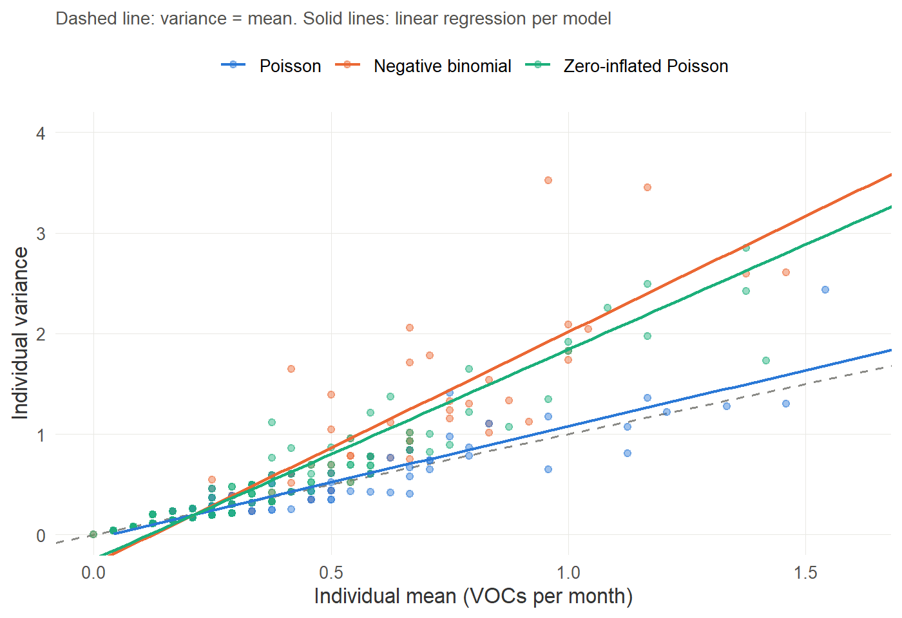
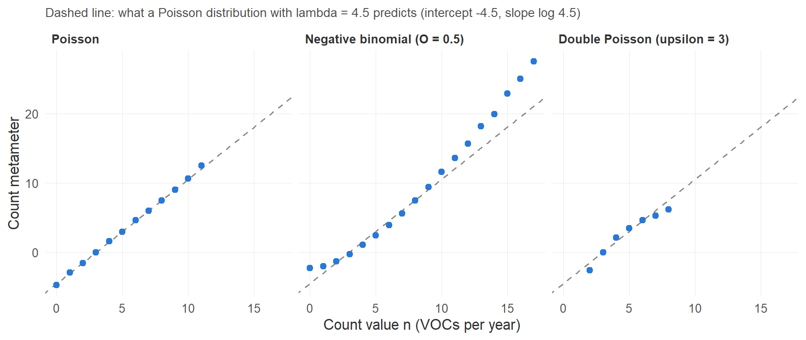
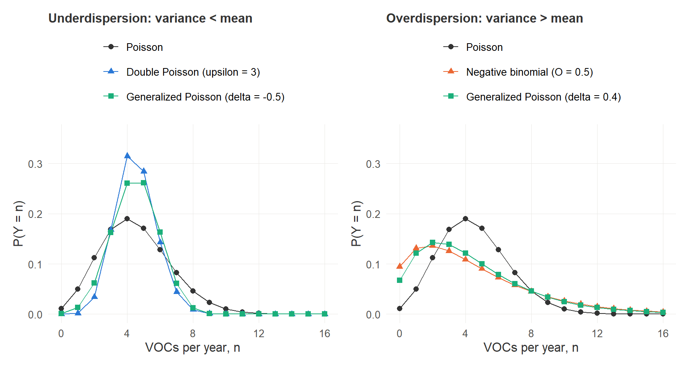
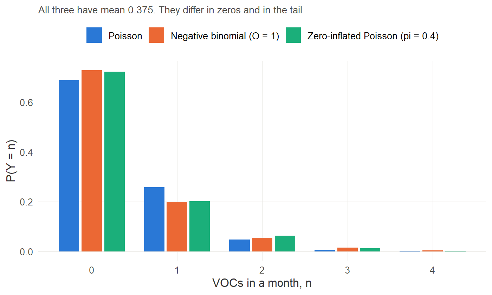
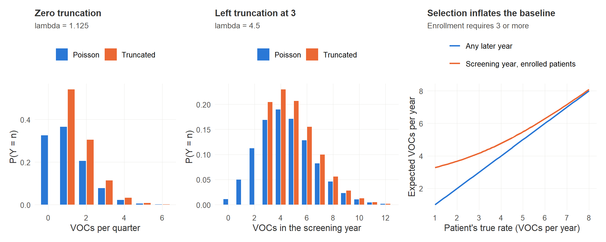
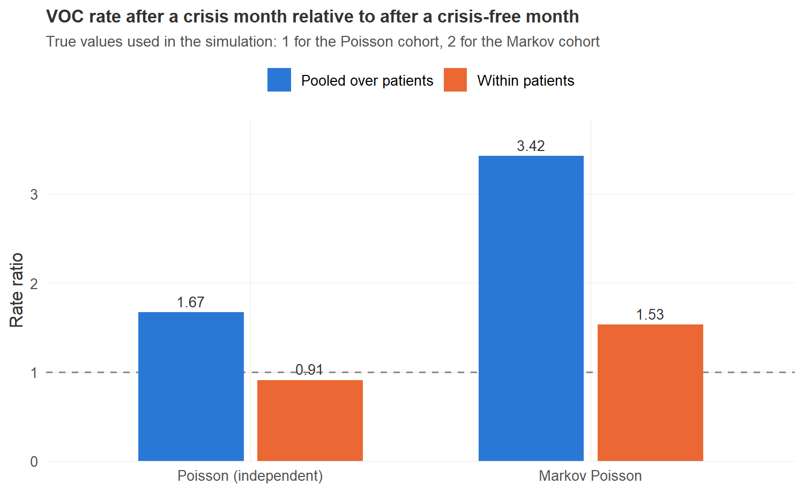
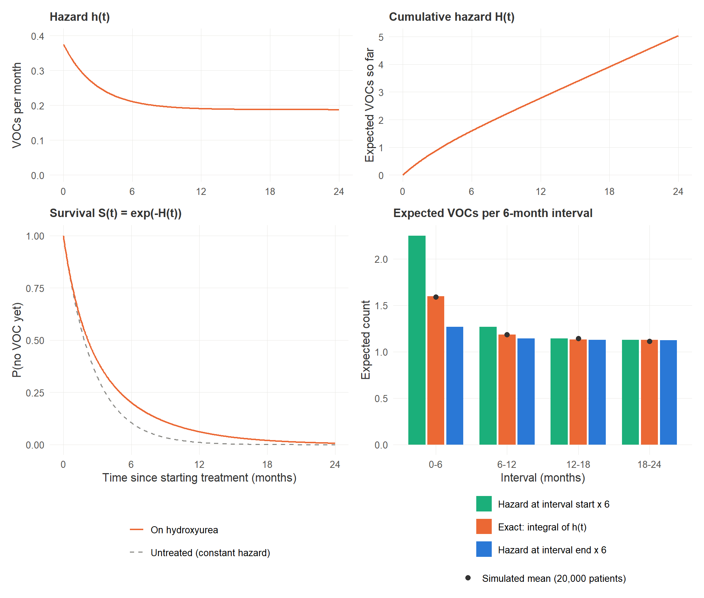

# Modeling Count Data in Pharmacometrics, Part 2: When the Poisson Assumptions Fail

*Part 2 of a three-part series based on Elodie Plan's tutorial "Modeling and Simulation of Count Data" (CPT: Pharmacometrics & Systems Pharmacology, 2014). Every figure is produced by R code you can run yourself: <https://github.com/Clint-Os/count-data-pmx>.*

**Series plan**

1. **Part 1:** data types, the hazard, the probability mass function, the Poisson model and its mean count function.
2. **Part 2 (this post):** what to do when the Poisson assumptions fail.
3. **Part 3:** the model-development workflow, diagnostics, simulation, and count models in drug development.

**After this post you should be able to**

- test whether count data are equidispersed, and say why pooled data cannot answer that question;
- write down the negative binomial, generalized Poisson, double Poisson and zero-inflated Poisson models and say what the extra parameter of each one does;
- handle truncated counts, and tell truncation from censoring;
- diagnose dependence between consecutive counts and add a Markov element to a count model;
- explain when a non-homogeneous Poisson model is needed.

---

## 1. Where we left off

Part 1 ended with a complete Poisson mixed-effects model and three assumptions:

| Assumption | In plain words |
|---|---|
| **Equidispersion** | Within a patient, the variance of the counts equals their mean: E(Y) = Var(Y) = λ |
| **Independence** | One event does not change the probability of the next |
| **Constant rate within intervals** | The hazard is flat inside each counting interval |

Each section below takes one assumption, shows how to detect a violation, and gives the models that repair it.

### The teaching datasets

The trial in Part 1 was simulated from a Poisson model, so it obeys every assumption and has nothing to diagnose. Here we simulate a simpler cohort four times: 100 untreated patients with sickle cell anemia, vaso-occlusive crises (VOCs) counted monthly for 24 months, no time trend. The typical rate is again 0.375 crises per month (4.5 per year) with between-patient variability ω = 0.6.

The same 100 patients, with the same individual mean counts λᵢ, appear in all four cohorts. Only the within-patient process differs: Poisson, negative binomial, zero-inflated Poisson, or Markov. Any difference between cohorts is therefore due to that process and nothing else.

The first script defines the probability mass functions (pmfs) used throughout; the second simulates the cohorts. Each model is explained in the section where it appears.

```r
# 02_count_distributions.R -- pmfs and random generators for the models in Part 2
# All are parameterized by the mean count `lambda` plus one dispersion parameter,
# following Plan (2014), so that each collapses to the Poisson model.

# Negative binomial: Var = lambda * (1 + omicron * lambda); Poisson as omicron -> 0
dnb <- function(n, lambda, omicron) dnbinom(n, mu = lambda, size = 1 / omicron)
rnb <- function(k, lambda, omicron) rnbinom(k, mu = lambda, size = 1 / omicron)

# Generalized Poisson (Consul & Jain 1973): Var = lambda / (1 - delta)^2; Poisson at delta = 0
# For delta < 0 the pmf is cut off where lambda*(1-delta) + n*delta <= 0, then renormalized.
dgp <- function(n, lambda, delta, n_max = 200) {
  raw <- function(k) {
    a <- lambda * (1 - delta)
    b <- a + k * delta
    ifelse(b > 0, exp(log(a) + (k - 1) * log(pmax(b, 1e-300)) - b - lgamma(k + 1)), 0)
  }
  raw(n) / sum(raw(0:n_max))
}

# Double Poisson (Efron 1986): mean ~ lambda, Var ~ lambda / upsilon; Poisson at upsilon = 1
# Normalized numerically; Efron's closed-form constant is an approximation to this.
ddp <- function(n, lambda, upsilon, n_max = 200) {
  raw <- function(k) {
    k_log_k <- ifelse(k == 0, 0, k * log(k))
    exp(0.5 * log(upsilon) - upsilon * lambda - k + k_log_k - lgamma(k + 1) +
          upsilon * k * (1 + log(lambda)) - upsilon * k_log_k)
  }
  raw(n) / sum(raw(0:n_max))
}

# Zero-inflated Poisson: a structural zero with probability pi0, otherwise Poisson(lambda_c)
dzip <- function(n, lambda_c, pi0) pi0 * (n == 0) + (1 - pi0) * dpois(n, lambda_c)
rzip <- function(k, lambda_c, pi0) ifelse(runif(k) < pi0, 0L, rpois(k, lambda_c))

# Draw from any pmf defined on 0..n_max
r_from_pmf <- function(k, pmf, n_max = 200) {
  sample(0:n_max, size = k, replace = TRUE, prob = pmf(0:n_max))
}
```

```r
# 03_simulate_violations.R -- four cohorts that differ only in how counts arise
# 100 untreated patients, 24 monthly VOC counts each, no time trend.
# The SAME patients (same lambda_i) are used in every scenario, so any difference
# between scenarios comes from the within-patient process alone.
source("R/00_setup.R")
source("R/02_count_distributions.R")
set.seed(2027)

n_id   <- 100
months <- 1:24
theta  <- 4.5 / 12      # typical VOCs per month
omega  <- 0.6           # between-patient SD on the log scale

omicron <- 1            # negative binomial overdispersion
pi0     <- 0.4          # zero-inflation probability
gamma   <- 1            # Markov: the rate doubles in the month after a crisis month

patients <- tibble(id = seq_len(n_id),
                   lambda_i = theta * exp(rnorm(n_id, 0, omega)))

simulate_markov <- function(lambda_i) {
  y    <- integer(length(months))
  prev <- rpois(1, lambda_i)                      # the unobserved month before the study
  for (j in seq_along(months)) {
    y[j] <- rpois(1, lambda_i * (1 + gamma * (prev > 0)))
    prev <- y[j]
  }
  y
}

cohort <- patients |>
  crossing(month = months) |>
  arrange(id, month) |>
  mutate(poisson = rpois(n(), lambda_i),
         negbin  = rnb(n(), lambda_i, omicron),
         zip     = rzip(n(), lambda_i / (1 - pi0), pi0)) |>
  group_by(id) |>
  mutate(markov = simulate_markov(first(lambda_i))) |>
  ungroup()

write.csv(cohort, "data/voc_violations_sim.csv", row.names = FALSE)

cohort |>
  pivot_longer(c(poisson, negbin, zip, markov), names_to = "scenario", values_to = "count") |>
  group_by(scenario) |>
  summarise(mean = mean(count), variance = var(count), pct_zero = 100 * mean(count == 0),
            max = max(count))
```

> **Lecturer's note.** These are simulated teaching data. Whether real VOC counts in a given population are overdispersed, clustered, or neither is an empirical question, and the methods below are how you would answer it.

---

## 2. Is the variance equal to the mean?

### The index of dispersion

For one patient with *T* counts, sample mean ȳᵢ and sample variance *s*ᵢ², the **index of dispersion** is their ratio:

$$
D_i = \frac{s_i^2}{\bar{y}_i}, \qquad (T-1)\,D_i \;\sim\; \chi^2_{T-1} \;\text{ if the counts are Poisson} \qquad (1)
$$

*D* = 1 is equidispersion, *D* > 1 is **overdispersion**, and *D* < 1 is **underdispersion**. Because the statistics of independent patients add, we can sum (T − 1)·Dᵢ over patients and compare the total with a chi-square distribution on the summed degrees of freedom. For our cohorts:

| Cohort | Combined dispersion ratio | p-value |
|---|---|---|
| Poisson | 1.02 | 0.22 |
| Negative binomial | 1.43 | < 0.001 |
| Zero-inflated Poisson | 1.33 | < 0.001 |

The test is computed **within patients**. If we ignore patients and pool all 2,400 counts of the Poisson cohort, we get a mean of 0.455 and a variance of 0.586, a ratio of 1.29. That apparent overdispersion is entirely between-patient variability, which the random effect η already models. Pooled data cannot tell you whether you need a different distribution.

### The mean–variance plot

The graphical version plots each patient's variance against their mean (Figure 9).



*Figure 9. One dot per patient. Poisson patients scatter around the identity line. Negative binomial and zero-inflated patients sit above it, and the gap widens as the mean increases.*

```r
# Figure 9 -- mean-variance plot: one dot per patient, 24 monthly counts each
source("R/00_setup.R")
cohort <- read.csv("data/voc_violations_sim.csv")

labels <- c(poisson = "Poisson", negbin = "Negative binomial", zip = "Zero-inflated Poisson")

per_patient <- cohort |>
  pivot_longer(c(poisson, negbin, zip), names_to = "model", values_to = "count") |>
  group_by(model, id) |>
  summarise(mean = mean(count), variance = var(count), .groups = "drop") |>
  mutate(model = factor(labels[model], levels = labels))

p <- ggplot(per_patient, aes(mean, variance, colour = model)) +
  geom_abline(slope = 1, intercept = 0, linetype = "dashed", colour = col_muted) +
  geom_point(alpha = 0.45, size = 1.6) +
  geom_smooth(method = "lm", formula = y ~ x, se = FALSE, linewidth = 0.8) +
  scale_colour_manual(values = c("Poisson" = col_placebo,
                                 "Negative binomial" = col_hu,
                                 "Zero-inflated Poisson" = col_third)) +
  coord_cartesian(xlim = c(0, 1.6), ylim = c(0, 4)) +
  labs(x = "Individual mean (VOCs per month)",
       y = "Individual variance",
       subtitle = "Dashed line: variance = mean. Solid lines: linear regression per model")

save_fig(p, "fig09_mean_variance.png", width = 7, height = 4.8)

# Index of dispersion, combined over patients: sum of (T - 1) * s^2 / mean ~ chi-square
dispersion_test <- per_patient |>
  filter(mean > 0) |>
  group_by(model) |>
  summarise(statistic = sum(23 * variance / mean), df = 23 * n(),
            ratio = statistic / df,
            p_value = pchisq(statistic, df, lower.tail = FALSE))
print(dispersion_test)

# The pooled trap: ignoring patients makes even Poisson data look overdispersed
cohort |> summarise(pooled_mean = mean(poisson), pooled_variance = var(poisson))
```

Read it this way: points along the dashed identity line support equidispersion; a regression line above it indicates overdispersion; one below it, underdispersion. Two cautions apply.

- With 24 counts per patient, each dot is noisy. Look at the trend, not at individual points.
- If the mean count changes over time, as it does on treatment, a patient's variance is inflated by the trend itself. Plan's advice is to stratify by time (for example, by study period) before reading the plot, and to draw only limited conclusions from the index of dispersion in that setting.

### The Poissonness plot

The third diagnostic asks whether the *whole shape* of the distribution is Poisson, and it comes from rearranging the pmf. If *N* observations follow a Poisson distribution, the expected frequency of the count value *n* is *f*ₙ = *N*·e^(−λ)·λⁿ / *n*!. Taking logs and moving the known quantities to the left:

$$
\phi(n) \;=\; \log\!\left(\frac{n!\; f_n}{N}\right) \;=\; -\lambda + n\,\log\lambda \qquad (2)
$$

The left-hand side is the **count metameter**. Plotted against *n*, Poisson data fall on a straight line with intercept −λ and slope log λ (Hoaglin, 1980). The idea is the same as a Q–Q plot.



*Figure 10. 2,000 simulated patient-years per panel, all with mean 4.5. Poisson data follow the line. Overdispersed data curve upward at both ends. Underdispersed data are flatter than the line, and the departure is harder to see.*

```r
# Figure 10 -- Poissonness plot (Hoaglin 1980)
source("R/00_setup.R")
source("R/02_count_distributions.R")
set.seed(11)

lambda <- 4.5          # VOCs per year, identical for everyone in this illustration
n_obs  <- 2000         # patient-years per model

sims <- bind_rows(
  tibble(model = "Poisson",                      count = rpois(n_obs, lambda)),
  tibble(model = "Negative binomial (O = 0.5)",  count = rnb(n_obs, lambda, 0.5)),
  tibble(model = "Double Poisson (upsilon = 3)",
         count = r_from_pmf(n_obs, function(n) ddp(n, lambda, 3)))
) |>
  mutate(model = factor(model, levels = unique(model)))

# count metameter: log(n! * f_n / N); a straight line in n if the data are Poisson
metameter <- sims |>
  count(model, count, name = "f_n") |>
  group_by(model) |>
  mutate(N = sum(f_n), phi = log(f_n) + lgamma(count + 1) - log(N)) |>
  filter(f_n >= 5) |>
  ungroup()

p <- ggplot(metameter, aes(count, phi)) +
  geom_abline(intercept = -lambda, slope = log(lambda), colour = col_muted,
              linetype = "dashed") +
  geom_point(colour = col_placebo, size = 2) +
  facet_wrap(~ model) +
  labs(x = "Count value n (VOCs per year)", y = "Count metameter",
       subtitle = "Dashed line: what a Poisson distribution with lambda = 4.5 predicts (intercept -4.5, slope log 4.5)")

save_fig(p, "fig10_poissonness.png", width = 9, height = 3.8)

metameter |> group_by(model) |>
  summarise(intercept = coef(lm(phi ~ count))[1], slope = coef(lm(phi ~ count))[2])
```

For clarity, Figure 10 uses annual counts from patients who all share one λ. In practice the plot is drawn per individual, or per stratum of similar individuals, for the same reason the dispersion test is: mixing patients with different λ bends the line even when every patient is Poisson. As Plan notes, the plot is better at revealing overdispersion than underdispersion, and no dispersion plot is conclusive, because counts are noisy and λ may follow a complex profile. Treat these plots as a reason to test alternative models, not as a verdict.

### What over- and underdispersion mean clinically

**Overdispersion** means that within-patient variability is large compared with the mean: the same patient has few events in most intervals and many in a few. It is typical of diseases with sudden outbreaks of symptoms. **Underdispersion** means unusually regular records, as in slowly progressive conditions with stable symptoms.

Sometimes the cause can be identified. Plan gives two examples: seizure counts that differ between morning and evening produce a bimodal distribution that can be mistaken for overdispersion, and migraines treated with rescue medication can look underdispersed. Often, though, the driver is unknown, and the dispersion has to be described by the model without an explanation.

One fact specific to low counts is worth knowing. For integer data with a mean below 1, the smallest possible variance is mean × (1 − mean), which is reached when every count is 0 or 1. At our monthly mean of 0.375, the dispersion ratio therefore cannot fall below 0.625. **Marked underdispersion cannot occur in rare-event data.** For monthly crisis counts, overdispersion is the violation to look for; underdispersion becomes relevant for frequent events, such as daily symptom counts.

---

## 3. Models for non-equidispersed counts

Each model below adds one parameter to the Poisson model and returns to it at a specific value of that parameter. That nesting is what makes the Poisson model the reference: you can always test whether the extra parameter is needed.

### Negative binomial

The negative binomial (NB) model is the main alternative when counts are overdispersed. Its extra parameter, written *O* (omicron) by Plan, lies in (0, ∞):

$$
P(Y_{ij} = n) \;=\; \frac{\Gamma\!\left(n + \tfrac{1}{O}\right)}{n!\;\Gamma\!\left(\tfrac{1}{O}\right)}
\left(\frac{1}{1 + O\lambda_i}\right)^{1/O}
\left(\frac{O\lambda_i}{1 + O\lambda_i}\right)^{n} \qquad (3)
$$

$$
E(Y_{ij}) = \lambda_i, \qquad \operatorname{Var}(Y_{ij}) = \lambda_i\,(1 + O\,\lambda_i) \qquad (4)
$$

The mean is still λ. The variance exceeds it by a term that grows with λ², which is why the gap in Figure 9 widens to the right. The distribution is not defined at *O* = 0 but tends to the Poisson as *O* approaches it.

**Where it comes from.** Suppose a patient's rate is not fixed but varies from one interval to the next, good months and bad months, following a gamma distribution with mean λᵢ and variance *O*·λᵢ². If the count in each interval is Poisson given that interval's rate, then averaging over the gamma distribution gives exactly equation 3. By the law of total variance,

$$
\operatorname{Var}(Y) = \underbrace{E(\Lambda)}_{\text{Poisson noise}} + \underbrace{\operatorname{Var}(\Lambda)}_{\text{rate fluctuation}} = \lambda_i + O\,\lambda_i^2
$$

This gives *O* a clinical reading. The random effect η describes differences **between patients** that persist over time. *O* describes fluctuation in the rate **within a patient** from one interval to the next that no covariate explains. If *O* is itself given a random effect, the model can describe some patients as Poisson-like and others as NB-like. The NB model has been found adequate for epilepsy seizure counts in several analyses.

In R, `dnbinom(n, mu = lambda, size = 1 / O)` is equation 3.

### Generalized Poisson

The generalized Poisson (GP) model of Consul and Jain handles both directions with one parameter, δ (delta):

$$
P(Y_{ij} = n) \;=\; \frac{a_i\,\bigl(a_i + n\,\delta\bigr)^{\,n-1}\; e^{-(a_i + n\,\delta)}}{n!},
\qquad a_i = \lambda_i\,(1 - \delta) \qquad (5)
$$

$$
E(Y_{ij}) = \lambda_i, \qquad \operatorname{Var}(Y_{ij}) = \frac{\lambda_i}{(1-\delta)^2} \qquad (6)
$$

δ > 0 gives overdispersion, δ < 0 gives underdispersion, and δ = 0 is the Poisson model. Unlike the NB, the dispersion ratio 1/(1 − δ)² does not depend on the mean.

The price is a restriction on δ:

$$
\max\!\left(-1,\; -\frac{a_i}{m}\right) \;\le\; \delta \;<\; 1 \qquad (7)
$$

where *m* ≥ 4 is the largest integer for which *a* + *m*δ > 0. For negative δ the term *a* + *n*δ eventually becomes negative, so the pmf is cut off at *n* = *m* and no longer sums exactly to 1. The lower bound depends on λ, which is itself being estimated. Plan's practical recipe is stepwise: fit with δ = 0 first, then use the estimated λ to set the lower bound for δ.

Our own example shows how tight the bound can be. At a monthly mean of 0.375, a value of δ = −0.3 would leave only two count values with positive probability, so it is not allowed. This is the low-count floor on underdispersion from section 2, appearing as a parameter constraint.

### Double Poisson

Efron's double Poisson (DP) model is usually chosen for underdispersion. Its parameter υ (upsilon) works in the opposite direction to the previous two: υ > 1 gives underdispersion, υ < 1 gives overdispersion, and υ = 1 is the Poisson model.

$$
P(Y_{ij} = n) \;=\; c(\lambda_i, \upsilon)\;\, \upsilon^{1/2}
\left(\frac{e^{-\lambda_i}\,\lambda_i^{\,n}}{n!}\right)^{\upsilon}
\left(\frac{e^{-n}\,n^{\,n}}{n!}\right)^{1-\upsilon} \qquad (8)
$$

$$
E(Y_{ij}) \approx \lambda_i, \qquad \operatorname{Var}(Y_{ij}) \approx \frac{\lambda_i}{\upsilon} \qquad (9)
$$

The construction explains the name. Equation 8 is an exponential combination of two Poisson densities: one with mean λ, raised to the power υ, and one with mean equal to the observation *n* itself, raised to 1 − υ. It belongs to the *double* exponential family, which extends the exponential family of Part 1 (section 8) with a dispersion parameter.

Without the factor *c*, equation 8 only approximates a pmf, because the probabilities do not sum exactly to 1. Efron's normalizing constant corrects this:

$$
\frac{1}{c(\lambda, \upsilon)} \;\approx\; 1 + \frac{1-\upsilon}{12\,\upsilon\,\lambda}\left(1 + \frac{1}{\upsilon\,\lambda}\right) \qquad (10)
$$

For λ = 4.5 and υ = 3, equation 10 gives 0.98674 and direct summation gives 0.98671. Our R function normalizes by direct summation.

### The three models compared



*Figure 11. All five distributions have mean 4.5 crises per year. Left: variances of 1.5 (double Poisson) and 2.0 (generalized Poisson) against 4.5 for the Poisson. Right: variances of 14.6 (negative binomial) and 12.5 (generalized Poisson).*

```r
# Figure 11 -- under- and overdispersed pmfs with the same mean as a Poisson
source("R/00_setup.R")
source("R/02_count_distributions.R")

lambda <- 4.5
n <- 0:16

under <- bind_rows(
  tibble(n, model = "Poisson",                          prob = dpois(n, lambda)),
  tibble(n, model = "Double Poisson (upsilon = 3)",     prob = ddp(n, lambda, 3)),
  tibble(n, model = "Generalized Poisson (delta = -0.5)", prob = dgp(n, lambda, -0.5))
) |> mutate(panel = "Underdispersion: variance < mean")

over <- bind_rows(
  tibble(n, model = "Poisson",                          prob = dpois(n, lambda)),
  tibble(n, model = "Negative binomial (O = 0.5)",      prob = dnb(n, lambda, 0.5)),
  tibble(n, model = "Generalized Poisson (delta = 0.4)", prob = dgp(n, lambda, 0.4))
) |> mutate(panel = "Overdispersion: variance > mean")

make_panel <- function(d, colours) {
  d$model <- factor(d$model, levels = names(colours))
  ggplot(d, aes(n, prob, colour = model, shape = model)) +
    geom_line(linewidth = 0.5) +
    geom_point(size = 2) +
    scale_colour_manual(values = colours) +
    scale_x_continuous(breaks = seq(0, 16, 4)) +
    scale_y_continuous(limits = c(0, 0.36)) +
    labs(title = unique(d$panel), x = "VOCs per year, n", y = "P(Y = n)") +
    guides(colour = guide_legend(ncol = 1), shape = guide_legend(ncol = 1))
}

p_under <- make_panel(under, c("Poisson" = col_ink,
                               "Double Poisson (upsilon = 3)" = col_placebo,
                               "Generalized Poisson (delta = -0.5)" = col_third))
p_over  <- make_panel(over,  c("Poisson" = col_ink,
                               "Negative binomial (O = 0.5)" = col_hu,
                               "Generalized Poisson (delta = 0.4)" = col_third))

save_fig(p_under + p_over, "fig11_dispersed_pmfs.png", width = 9, height = 4.8)

# mean and variance of each pmf
summ <- function(p, k = 0:200) { m <- sum(k * p); c(mean = m, variance = sum((k - m)^2 * p)) }
k <- 0:200
round(rbind(Poisson = summ(dpois(k, lambda)),
            DP_3    = summ(ddp(k, lambda, 3)),
            GP_neg  = summ(dgp(k, lambda, -0.5)),
            NB_0.5  = summ(dnb(k, lambda, 0.5)),
            GP_pos  = summ(dgp(k, lambda, 0.4))), 2)
```

Clinically, the left panel describes a population in which almost everyone has between 3 and 6 crises a year. The right panel describes one with the same average in which crisis-free years and years with 12 or more crises are both common. A Poisson model fitted to the right-hand population would understate both, and would report standard errors that are too small.

| Model | Extra parameter | Poisson when | Variance | Handles |
|---|---|---|---|---|
| Negative binomial | *O* > 0 | *O* → 0 | λ(1 + *O*λ) | Overdispersion |
| Generalized Poisson | δ < 1, bounded below | δ = 0 | λ / (1 − δ)² | Both |
| Double Poisson | υ > 0 | υ = 1 | ≈ λ / υ | Both, mainly under |

### Excess zeros, mixtures, and other models

**Zero-inflated Poisson (ZIP).** A frequent form of overdispersion is an excess of one value, usually zero. The ZIP model mixes two components: a "structural" zero with probability π, and a Poisson count with mean λ_c otherwise:

$$
P(Y = 0) = \pi + (1-\pi)\,e^{-\lambda_c}, \qquad
P(Y = n) = (1-\pi)\,\frac{\lambda_c^{\,n}\,e^{-\lambda_c}}{n!} \quad (n \ge 1) \qquad (11)
$$

with mean (1 − π)·λ_c and variance equal to the mean × (1 + π·λ_c). Plan gives two situations that produce it: a threshold that must be crossed before any event is observed, and poor compliance with recording. The second is directly relevant to diary and recall data: a month recorded as zero may be a month without a crisis or a month without a record.

**Hurdle model.** Also a two-part model: one probability for zero versus non-zero, and a zero-truncated count distribution (section 4) for the positive counts.

**Mixture models.** If two or more processes can each produce an event, a model with two or more λ values describes a population whose combined counts are more variable than either component.

**Others.** Zero inflation can be combined with the NB or any other count distribution. Further models with both over- and underdispersion include the compound generalized Poisson, the generalized event count model, and the Conway–Maxwell–Poisson model.

### The same mean, three different clinical pictures



*Figure 12. Three models for a typical patient's monthly crisis count, all with mean 0.375.*

```r
# Figure 12 -- three models with the same mean of 0.375 VOCs per month
source("R/00_setup.R")
source("R/02_count_distributions.R")

lambda <- 4.5 / 12
pi0    <- 0.4
n      <- 0:4

pmf <- bind_rows(
  tibble(n, model = "Poisson",                         prob = dpois(n, lambda)),
  tibble(n, model = "Negative binomial (O = 1)",       prob = dnb(n, lambda, 1)),
  tibble(n, model = "Zero-inflated Poisson (pi = 0.4)", prob = dzip(n, lambda / (1 - pi0), pi0))
) |> mutate(model = factor(model, levels = unique(model)))

p <- ggplot(pmf, aes(n, prob, fill = model)) +
  geom_col(position = position_dodge(width = 0.8), width = 0.72) +
  scale_fill_manual(values = c(col_placebo, col_hu, col_third)) +
  labs(x = "VOCs in a month, n", y = "P(Y = n)",
       subtitle = "All three have mean 0.375. They differ in zeros and in the tail")

save_fig(p, "fig12_same_mean_different_shape.png", width = 7, height = 4.2)

k <- 0:200
pmf_full <- list(Poisson = dpois(k, lambda), NB = dnb(k, lambda, 1),
                 ZIP = dzip(k, lambda / (1 - pi0), pi0))
round(sapply(pmf_full, function(p) c(mean = sum(k * p),
                                     variance = sum((k - sum(k * p))^2 * p),
                                     p_zero = p[1], p_two_or_more = 1 - p[1] - p[2])), 3)
```

| | Poisson | Negative binomial (*O* = 1) | Zero-inflated Poisson (π = 0.4) |
|---|---|---|---|
| Mean | 0.375 | 0.375 | 0.375 |
| Variance | 0.375 | 0.516 | 0.469 |
| P(crisis-free month) | 68.7% | 72.7% | 72.1% |
| P(two or more crises in a month) | 5.5% | 7.4% | 7.8% |

The three models agree on the average and disagree on what matters to a patient and to a health service. Under the NB and ZIP models there are more crisis-free months *and* more months with repeated crises. If a trial's endpoint or a clinic's planning depends on the frequency of bad months, the Poisson model understates it by about a quarter, although its mean is correct.

---

## 4. Truncation and censoring

A different route to non-equidispersion is that part of the distribution is missing from the data.

**Right truncation** occurs when counts above a fixed value *c*ᵣ cannot occur in the data. **Left truncation** occurs when counts below a value *c*ₗ cannot. The most common case is **zero truncation**, *c*ₗ = 1.

Any of the count models above can be used, but the pmf must be rescaled so that the remaining probabilities sum to 1. This is done by dividing by the probability of the range that can be observed:

$$
P(Y = n \mid Y \le c_r) = \frac{P(Y = n)}{\sum_{k=0}^{c_r} P(Y = k)}, \qquad
P(Y = n \mid Y \ge c_l) = \frac{P(Y = n)}{1 - \sum_{k=0}^{c_l - 1} P(Y = k)} \qquad (12)
$$

### Two clinical examples

**Zero truncation.** A hospital register that contains only patients admitted with a crisis during the quarter cannot contain a zero. Fitting an ordinary Poisson model to it overestimates the rate.

**Left truncation at 3.** The Multicenter Study of Hydroxyurea enrolled adults with at least three crises in the previous year. The pre-enrollment count of every participant is therefore truncated at 3.



*Figure 13. Left and center: truncation removes the low counts and rescales the rest. Right: for patients enrolled on a "three or more" criterion, the expected count in the screening year is higher than their true long-run rate.*

```r
# Figure 13 -- truncated count distributions and the regression to the mean they cause
source("R/00_setup.R")

truncate_left <- function(lambda, c_l, n = 0:200) {        # keep counts >= c_l
  p <- dpois(n, lambda) * (n >= c_l)
  p / sum(p)
}

# (a) zero truncation: a clinic register that only contains patients seen with a crisis
n_a <- 0:6
a <- bind_rows(
  tibble(n = n_a, what = "Poisson", prob = dpois(n_a, 1.125)),
  tibble(n = n_a, what = "Truncated", prob = truncate_left(1.125, 1)[n_a + 1])
)
# (b) left truncation at 3: enrolment requires at least 3 crises in the previous year
n_b <- 0:12
b <- bind_rows(
  tibble(n = n_b, what = "Poisson", prob = dpois(n_b, 4.5)),
  tibble(n = n_b, what = "Truncated", prob = truncate_left(4.5, 3)[n_b + 1])
)

bars <- function(d, title, subtitle, xlab) {
  ggplot(d, aes(n, prob, fill = what)) +
    geom_col(position = position_dodge(width = 0.8), width = 0.72) +
    scale_fill_manual(values = c(Poisson = col_placebo, Truncated = col_hu)) +
    scale_x_continuous(breaks = unique(d$n)[unique(d$n) %% 2 == 0]) +
    labs(title = title, subtitle = subtitle, x = xlab, y = "P(Y = n)")
}
p_a <- bars(a, "Zero truncation", "lambda = 1.125", "VOCs per quarter")
p_b <- bars(b, "Left truncation at 3", "lambda = 4.5", "VOCs in the screening year")

# (c) regression to the mean: expected screening-year count among those enrolled
rtm <- tibble(lambda = seq(1, 8, by = 0.1)) |>
  rowwise() |>
  mutate(`Screening year, enrolled patients` = sum((0:200) * truncate_left(lambda, 3)),
         `Any later year` = lambda) |>
  ungroup() |>
  pivot_longer(-lambda, names_to = "what", values_to = "expected")

p_c <- ggplot(rtm, aes(lambda, expected, colour = what)) +
  geom_line(linewidth = 0.9) +
  scale_colour_manual(values = c("Screening year, enrolled patients" = col_hu,
                                 "Any later year" = col_placebo)) +
  scale_x_continuous(breaks = 1:8) +
  labs(title = "Selection inflates the baseline", subtitle = "Enrollment requires 3 or more",
       x = "Patient's true rate (VOCs per year)", y = "Expected VOCs per year") +
  guides(colour = guide_legend(ncol = 1))

save_fig(p_a + p_b + p_c + plot_layout(widths = c(1, 1.3, 1.2)),
         "fig13_truncation.png", width = 11, height = 4.4)

rtm |> filter(lambda %in% c(2.5, 4.5, 6)) |> pivot_wider(names_from = what, values_from = expected)
```

Truncation changes both moments. For the zero-truncated quarter (λ = 1.125), the mean rises to 1.67 and the dispersion ratio falls to 0.46. For the screening year (λ = 4.5), the mean rises to 5.11 and the ratio falls to 0.63. Truncated data look underdispersed even when the underlying process is exactly Poisson.

The right-hand panel has a direct consequence for trial interpretation. Take a patient whose true rate is 2.5 crises a year. They qualify for the trial only in a year in which they happen to have three or more, and among such years the expected count is 3.91. The following year their expected count is 2.5 again. That is an apparent 36% reduction with no treatment at all. For a true rate of 4.5 the apparent reduction is 12%, and for 6.0 it is 5%.

This is **regression to the mean**, and it is the origin of the time effect *f*(*t*) we placed in the mean count function in Part 1. It is also why a before-and-after comparison in patients selected for high baseline counts overstates a drug effect unless the selection is modeled or a control arm is present.

> **Truncation is not censoring.** Plan's text uses the two words together, so it is worth separating them.
>
> - **Truncated:** the observation cannot appear in the dataset at all (the patient with zero crises is not in the register). The remedy is equation 12: rescale the pmf.
> - **Censored:** the observation is in the dataset, but only as a bound. A diary with tick boxes "0, 1, 2, 3 or more" records a patient with five crises as "3 or more". The likelihood of that record is the probability of the whole range, P(Y ≥ 3), and the pmf is not rescaled.
>
> Using the wrong one biases the estimate of λ, so establish which applies from how the data were collected.

---

## 5. When one event changes the chance of the next

### Why independence is doubtful

The Poisson model assumes that events occur independently. For disease symptoms this is often questionable. Plan gives three patterns:

- **Events that trigger events.** In epilepsy, the idea that "seizures beget seizures" is debated.
- **Clustering.** Migraines appear to alternate between low-activity periods and peaks, which suggests an underlying, indirect dependence.
- **Regular spacing.** Micturition has a behavioral component that makes events more evenly spaced than a random process would.

In sickle cell disease, a US Medicaid analysis of more than 39,000 adult admissions for crisis found a 30-day readmission rate of 39.6% (Nouraie and Gordeuk, 2015). That is suggestive of clustering, but as we are about to see, a pooled figure like this cannot by itself distinguish clustering from differences between patients.

### Diagnosing dependence

The simplest diagnostic plots or tabulates each count against the one before it. With rare events, a table is clearer than a scatter plot: compare the crisis rate in months that follow a crisis month with the rate in months that follow a crisis-free month.



*Figure 14. The Poisson cohort has no dependence at all; the Markov cohort was simulated with the rate doubling in the month after a crisis month.*

```r
# Figure 14 -- diagnosing dependence between consecutive counts
# Rate ratio: mean count in a month that follows a crisis month,
#             divided by the mean count in a month that follows a crisis-free month.
source("R/00_setup.R")
cohort <- read.csv("data/voc_violations_sim.csv")

lagged <- cohort |>
  pivot_longer(c(poisson, markov), names_to = "model", values_to = "count") |>
  mutate(model = factor(ifelse(model == "poisson", "Poisson (independent)", "Markov Poisson"),
                        levels = c("Poisson (independent)", "Markov Poisson"))) |>
  group_by(model, id) |>
  arrange(month, .by_group = TRUE) |>
  mutate(previous = lag(count)) |>
  ungroup() |>
  filter(!is.na(previous)) |>
  mutate(after_crisis = previous > 0)

# (a) naive: pool all patient-months
pooled <- lagged |>
  group_by(model) |>
  summarise(rate_ratio = mean(count[after_crisis]) / mean(count[!after_crisis])) |>
  mutate(method = "Pooled over patients")

# (b) within patients: Mantel-Haenszel rate ratio, each patient is a stratum
within <- lagged |>
  group_by(model, id) |>
  summarise(a  = sum(count[after_crisis]),  n1 = sum(after_crisis),
            b  = sum(count[!after_crisis]), n0 = sum(!after_crisis), .groups = "drop") |>
  group_by(model) |>
  summarise(rate_ratio = sum(a * n0 / (n1 + n0)) / sum(b * n1 / (n1 + n0))) |>
  mutate(method = "Within patients")

both <- bind_rows(pooled, within) |>
  mutate(method = factor(method, levels = c("Pooled over patients", "Within patients")))

p <- ggplot(both, aes(model, rate_ratio, fill = method)) +
  geom_hline(yintercept = 1, linetype = "dashed", colour = col_muted) +
  geom_col(position = position_dodge(width = 0.7), width = 0.62) +
  geom_text(aes(label = sprintf("%.2f", rate_ratio)),
            position = position_dodge(width = 0.7), vjust = -0.5, size = 3.4, colour = col_ink) +
  scale_fill_manual(values = c("Pooled over patients" = col_placebo,
                               "Within patients" = col_hu)) +
  scale_y_continuous(expand = expansion(mult = c(0, 0.12))) +
  labs(x = NULL, y = "Rate ratio",
       title = "VOC rate after a crisis month relative to after a crisis-free month",
       subtitle = "True values used in the simulation: 1 for the Poisson cohort, 2 for the Markov cohort")

save_fig(p, "fig14_dependence.png", width = 7.5, height = 4.6)
print(both)
```

Figure 14 contains two lessons.

**Pooling manufactures dependence.** In the independent Poisson cohort, the pooled rate after a crisis month is 1.67 times the rate after a crisis-free month. Nothing in the simulation links one month to the next. The ratio arises because high-rate patients contribute most of the "crisis last month" observations *and* have more crises this month. It is the same trap as pooled overdispersion in section 2: between-patient variability, read as a within-patient phenomenon.

**The within-patient comparison points the right way, but is biased.** Stratifying by patient (a Mantel–Haenszel rate ratio) removes the between-patient effect: 0.91 for the Poisson cohort and 1.53 for the Markov cohort. The two cohorts are now clearly separated. But neither value equals the truth (1 and 2). In a short series, comparing months within one patient biases the ratio downward. The practical conclusion is to read such a diagnostic against a reference simulated from the model with no dependence, not against 1. Simulation-based diagnostics of this kind are the subject of Part 3.

Individual time courses also help: dependence tends to show as runs of similar values, with profiles that are smoother than independent counts would produce.

### How serial correlation is handled for continuous data

In statistics this property is called **serial correlation**. For continuous outcomes, pharmacometrics has two established approaches.

The **first-order autoregressive model, AR(1)**, correlates the residual errors of the same individual, with a correlation that decays as observations get further apart in time:

$$
\operatorname{corr}(\varepsilon_{ij}, \varepsilon_{ik}) = \rho^{\,|t_{ij} - t_{ik}|} \qquad (13)
$$

**Stochastic differential equations (SDEs)** split the residual error into measurement noise and *system* noise, which enters the dynamics of the model state itself:

$$
dx_t = f(x_t, t)\,dt + \sigma_w\,dw_t, \qquad y_{ij} = g(x_{t_{ij}}) + \varepsilon_{ij} \qquad (14)
$$

Both rely on a continuous residual, and Plan notes that both had been described only for continuous processes. Count data have no additive residual to correlate, so a different device is needed.

### Markov models for counts

For discrete data, the published methods mainly use **Markov models**, in which an observation depends on previous states. When the dependence is on the immediately preceding observation, the model is **first-order**; it can also reach back two observations (second-order), and so on. Because the observations occur on a set of measurement occasions, the full name is a **discrete-time Markov chain**.

A Markov element enters a count model as a function of the previous observation that modifies the probability of the current one:

$$
P\bigl(Y_{ij} = n \mid Y_{i,j-1}\bigr) = f\bigl(n;\; \lambda_i;\; Y_{i,j-1}\bigr) \qquad (15)
$$

The previous observation is known, so it enters the model directly, like a time-varying covariate. Most implementations follow the Markov regression models of Zeger and Qaqish and act either by changing λ or through inflation and deflation probabilities, as in the zero-inflated model. The two parameterizations met most often in pharmacodynamic count models are:

- **A continuous function of the previous count.** For example, a proportional Emax function, used for seizure counts:

$$
\lambda_{ij} = \lambda_i \left(1 + \frac{E_{\max}\; Y_{i,j-1}}{Y_{50} + Y_{i,j-1}}\right) \qquad (16)
$$

- **A function of the previous status, events or no events.** This is what we simulated:

$$
\lambda_{ij} = \lambda_i \bigl(1 + \gamma \cdot \mathbf{1}[Y_{i,j-1} > 0]\bigr) \qquad (17)
$$

With γ = 1 in equation 17, a crisis month doubles the expected count of the following month. In the simulation code this is the line `rpois(1, lambda_i * (1 + gamma * (prev > 0)))`.

Two practical points. The first observation of each patient has no predecessor, so the model needs a rule for it (we drew an unobserved "month zero" from the patient's baseline distribution). And λᵢ changes meaning: it is now the mean count *after a crisis-free month*, not the overall mean. The Markov cohort has an overall mean of 0.70 per month from the same λᵢ that give 0.46 in the Poisson cohort.

### Hidden and continuous-time Markov models

Two relatives of this model deserve a mention.

In a **hidden Markov model**, the state that influences the current observation is *not* observed. The patient moves between latent states, for example a stable state and a vulnerable state, and the state they occupy at a given time changes the probabilities of the observations at that time. This has been implemented for mixed-effects count models in epilepsy.

In a **continuous-time Markov model**, transitions between states are not tied to measurement occasions and can occur at any moment, governed by transition rates.

I work through both, with the mathematics and code, in a separate repository: <https://github.com/Clint-Os/Markov-Models>.

---

## 6. When the rate changes within an interval

### Homogeneous and non-homogeneous processes

Every model so far assumes that the hazard is constant inside each counting interval. A process with that property is a **homogeneous Poisson process** within the interval. Relaxing it gives a **non-homogeneous** (or inhomogeneous) **Poisson process**, in which the count intensity λᵢ(*u*) varies continuously with time.

The expected count over an interval is then the integral of the intensity:

$$
E\bigl(Y_{i,(j-1,\,j)}\bigr) = \int_{t_{j-1}}^{t_j} \lambda_i(u)\,du \qquad (18)
$$

Here λᵢ(*u*) has the same structure as the mean count function of Part 1, but the exposure term can now be the drug concentration at time *u*, no longer averaged over the interval, and covariates can vary in time. λ acts as a hazard that accumulates. The likelihood of a positive count is given by the chosen pmf evaluated at the integral, and the likelihood of a zero count equals the survivor function, exp(−∫λ). This is the link of Part 1 (λ = *h*·Δ*t*) without the restriction to a constant hazard. In most cases the integral has no closed form and is solved with ordinary differential equations.

### When does it matter?

Plan separates three situations.

- **Rare adverse events.** The within-interval time course is seldom important and is rarely estimable from sparse data.
- **Cycles as long as the interval.** A circadian rhythm cannot be recovered from daily counts.
- **A fast-changing driver.** If a biomarker or a drug concentration known to influence the hazard changes appreciably within the interval, the homogeneous assumption needs to be relaxed.

Figure 15 shows the third situation with our example: a typical patient starting hydroxyurea, with the drug effect building over the first months.



*Figure 15. Top: the hazard falls from 0.375 to 0.19 crises per month, and the cumulative hazard is its integral. Bottom left: the probability of remaining crisis-free. Bottom right: expected counts per six-month interval computed exactly and with two homogeneous shortcuts; dots are simulated means.*

```r
# Figure 15 -- a non-homogeneous Poisson process: hazard, cumulative hazard, survival, counts
source("R/00_setup.R")
set.seed(15)

h0    <- 4.5 / 12                 # VOCs per month before treatment
e_max <- 0.50
k_on  <- log(2) / 2

h <- function(t) h0 * (1 - e_max * (1 - exp(-k_on * t)))                 # hazard
H <- function(t) h0 * ((1 - e_max) * t + e_max * (1 - exp(-k_on * t)) / k_on)  # its integral

grid <- tibble(t = seq(0, 24, by = 0.05)) |>
  mutate(hazard = h(t), cum_hazard = H(t), survival = exp(-H(t)),
         survival_untreated = exp(-h0 * t))

p_h <- ggplot(grid, aes(t, hazard)) + geom_line(colour = col_hu, linewidth = 0.8) +
  scale_y_continuous(limits = c(0, 0.4)) + scale_x_continuous(breaks = seq(0, 24, 6)) +
  labs(title = "Hazard h(t)", x = NULL, y = "VOCs per month")
p_H <- ggplot(grid, aes(t, cum_hazard)) + geom_line(colour = col_hu, linewidth = 0.8) +
  scale_x_continuous(breaks = seq(0, 24, 6)) +
  labs(title = "Cumulative hazard H(t)", x = NULL, y = "Expected VOCs so far")
p_S <- ggplot(grid, aes(t)) +
  geom_line(aes(y = survival_untreated, linetype = "Untreated (constant hazard)"),
            colour = col_muted, linewidth = 0.6) +
  geom_line(aes(y = survival, linetype = "On hydroxyurea"), colour = col_hu, linewidth = 0.8) +
  scale_linetype_manual(values = c("On hydroxyurea" = "solid",
                                   "Untreated (constant hazard)" = "dashed")) +
  scale_x_continuous(breaks = seq(0, 24, 6)) +
  labs(title = "Survival S(t) = exp(-H(t))", x = "Time since starting treatment (months)",
       y = "P(no VOC yet)") +
  guides(linetype = guide_legend(ncol = 1)) +
  theme(legend.position = "bottom")

# expected counts per 6-month interval, three ways
ends <- seq(6, 24, by = 6)
expected <- tibble(end = ends, start = ends - 6) |>
  mutate(`Exact: integral of h(t)`        = H(end) - H(start),
         `Hazard at interval start x 6`   = h(start) * 6,
         `Hazard at interval end x 6`     = h(end) * 6)

# check the integral by simulation: thinning a homogeneous process of rate h0
simulate_times <- function() {
  t <- cumsum(rexp(60, rate = h0)); t <- t[t <= 24]
  t[runif(length(t)) < h(t) / h0]
}
sim_counts <- replicate(20000, tabulate(ceiling(simulate_times() / 6), nbins = 4))
expected$simulated <- rowMeans(sim_counts)

bars <- expected |>
  select(-simulated) |>
  pivot_longer(-c(start, end), names_to = "method", values_to = "count") |>
  mutate(interval = factor(sprintf("%d-%d", start, end), levels = sprintf("%d-%d", ends - 6, ends)),
         method = factor(method, levels = c("Hazard at interval start x 6",
                                            "Exact: integral of h(t)",
                                            "Hazard at interval end x 6")))
p_N <- ggplot(bars, aes(interval, count, fill = method)) +
  geom_col(position = position_dodge(width = 0.8), width = 0.72) +
  geom_point(data = mutate(expected, interval = factor(sprintf("%d-%d", start, end))),
             aes(interval, simulated, shape = "Simulated mean (20,000 patients)"),
             inherit.aes = FALSE, size = 2.2, colour = col_ink) +
  scale_fill_manual(values = c(col_third, col_hu, col_placebo)) +
  labs(title = "Expected VOCs per 6-month interval", x = "Interval (months)", y = "Expected count") +
  guides(fill = guide_legend(ncol = 1, order = 1), shape = guide_legend(order = 2)) +
  theme(legend.position = "bottom", legend.box = "vertical", legend.margin = margin(0, 0, 0, 0))

save_fig((p_h + p_H) / (p_S + p_N) + plot_layout(heights = c(1, 1.5)),
         "fig15_nonhomogeneous.png", width = 10, height = 8.5)
print(as.data.frame(expected))

# how much does "hazard at the end of each month" (used in Part 1) miss with monthly intervals?
m <- 1:24
c(exact_24_months = H(24), end_of_month_sum = sum(h(m)), start_of_month_sum = sum(h(m - 1)))
```

How to read the four panels:

- **Hazard.** The instantaneous crisis rate, which falls by almost half over the first six months.
- **Cumulative hazard.** The expected number of crises so far. Its slope at any time is the hazard, so the curve bends early and then becomes a straight line.
- **Survival.** The probability of no crisis yet. The chance of a crisis-free first year rises from 1.1% untreated to 6.2% on treatment, and the median time to first crisis moves from 1.8 to 2.2 months. That shift is modest because most first crises happen early, before the drug effect has built up.
- **Expected counts.** With six-monthly visits, the exact expected count in the first interval is 1.60. A homogeneous model using the hazard at the start of the interval gives 2.25 (41% too high); using the hazard at the end gives 1.27 (21% too low). From the second interval on, the hazard is nearly flat and all three agree.

The error depends on the interval length. In Part 1 we evaluated the drug effect at the end of each *month*; over 24 months that shortcut gives 4.95 expected crises against an exact 5.04, an error under 2%. With monthly counts the homogeneous model was adequate. With six-monthly counts during treatment initiation it would not be.

Plan noted that published pharmacometric applications of non-homogeneous Poisson models were relatively sparse.

### Intervals of unequal length

A non-homogeneous model integrates over elapsed time, so it handles unequal intervals automatically. A homogeneous model can handle them too, using the result from Part 1:

$$
\lambda_{ij} = \lambda_i \cdot (t_j - t_{j-1}) \qquad (19)
$$

where λᵢ is now a rate per unit time. If crises are counted daily during an admission and monthly in outpatient follow-up, both kinds of record can be analyzed together without collapsing the daily counts into monthly ones.

---

## 7. Which model, when

| What you see | Check | Model to try | Extra parameter |
|---|---|---|---|
| Within-patient variance above the mean | Dispersion test, mean–variance plot | Negative binomial; generalized Poisson | *O*; δ > 0 |
| More zeros than the model predicts | Observed against predicted frequency of zero | Zero-inflated or hurdle model | π |
| Within-patient variance below the mean (frequent events) | Mean–variance plot | Double Poisson; generalized Poisson | υ > 1; δ < 0 |
| Counts that cannot fall below or rise above a limit | How the data were collected | Truncated pmf (equation 12) | none |
| Counts recorded as "*c* or more" | How the data were collected | Censored likelihood | none |
| Runs of similar counts within patients | Within-patient lag comparison against a simulated reference | Markov element | γ, or Emax and Y₅₀ |
| A hazard driver that changes within the interval | Interval length against the speed of the driver | Non-homogeneous Poisson | none (structural) |

Three points to carry forward.

1. **Diagnose within patients.** Pooled data showed overdispersion (ratio 1.29) and dependence (ratio 1.67) in a cohort that had neither.
2. **The violations overlap.** A Markov process also inflates the variance, and unmodeled time trends mimic both overdispersion and dependence. A diagnostic that flags one violation does not identify its cause.
3. **Diagnostics suggest; model comparison decides.** Every model here contains the Poisson model as a special case, so the extra parameter can be tested formally.

How to make that comparison, with the likelihood ratio test, residuals for count data, and visual predictive checks, is Part 3.

---

## Check your understanding

1. A patient has monthly counts with mean 0.8 and variance 1.6 over 24 months. Compute the index of dispersion and the test statistic. Is this evidence against the Poisson model?
2. In the negative binomial model with λ = 0.5 and *O* = 1, what is the variance? What does *O* represent that η does not?
3. A register contains only patients with at least one crisis in the year. For λ = 2, what is the probability that a registered patient had exactly one crisis?
4. In a pooled dataset, months after a crisis have twice the crisis rate of other months. Give two different explanations.

<details>
<summary>Answers</summary>

1. *D* = 1.6 / 0.8 = 2. Statistic = 23 × 2 = 46 on 23 degrees of freedom; the 95th percentile of that chi-square distribution is 35.2, so yes, for this patient. Check that there is no time trend before concluding.
2. Variance = 0.5 × (1 + 1 × 0.5) = 0.75. *O* describes interval-to-interval fluctuation of the rate within a patient; η describes a persistent difference between patients.
3. P(Y = 1 | Y ≥ 1) = 2e⁻² / (1 − e⁻²) = 0.2707 / 0.8647 = 0.313.
4. True dependence (a crisis raises the short-term risk of another), or between-patient variability (high-rate patients supply most of the "after a crisis" months). Only a within-patient analysis separates them.

</details>

---

## References

1. Plan EL. Modeling and simulation of count data. *CPT Pharmacometrics Syst Pharmacol.* 2014;3:e129. doi:10.1038/psp.2014.27
2. Hoel PG. On indices of dispersion. *Ann Math Stat.* 1943;14:155–162.
3. Hoaglin DC. A Poissonness plot. *Am Stat.* 1980;34:146–149.
4. Consul PC, Jain GC. A generalization of the Poisson distribution. *Technometrics.* 1973;15:791–799.
5. Efron B. Double exponential families and their use in generalized linear regression. *J Am Stat Assoc.* 1986;81:709.
6. Trocóniz IF, Plan EL, Miller R, Karlsson MO. Modelling overdispersion and Markovian features in count data. *J Pharmacokinet Pharmacodyn.* 2009;36:461–477.
7. Ahn JE, Plan EL, Karlsson MO, Miller R. Modeling longitudinal daily seizure frequency data from pregabalin add-on treatment. *J Clin Pharmacol.* 2012;52:880–892.
8. Zeger SL, Qaqish B. Markov regression models for time series: a quasi-likelihood approach. *Biometrics.* 1988;44:1019.
9. Karlsson MO, Beal SL, Sheiner LB. Three new residual error models for population PK/PD analyses. *J Pharmacokinet Biopharm.* 1995;23:651–672.
10. Tornøe CW, Overgaard RV, Agersø H, Nielsen HA, Madsen H, Jonsson EN. Stochastic differential equations in NONMEM: implementation, application, and comparison with ordinary differential equations. *Pharm Res.* 2005;22:1247–1258.
11. Delattre M, Savic RM, Miller R, Karlsson MO, Lavielle M. Analysis of exposure–response of CI-945 in patients with epilepsy: application of novel mixed hidden Markov modeling methodology. *J Pharmacokinet Pharmacodyn.* 2012;39:263–271.
12. Charache S, Terrin ML, Moore RD, et al. Effect of hydroxyurea on the frequency of painful crises in sickle cell anemia. *N Engl J Med.* 1995;332:1317–1322.
13. Nouraie M, Gordeuk VR. Blood transfusion and 30-day readmission rate in adult patients hospitalized with sickle cell disease crisis. *Transfusion.* 2015. doi:10.1111/trf.13155

*The figures in this post are original and generated from simulated data. They follow the teaching sequence of Plan (2014) and do not reproduce that article's figures.*
